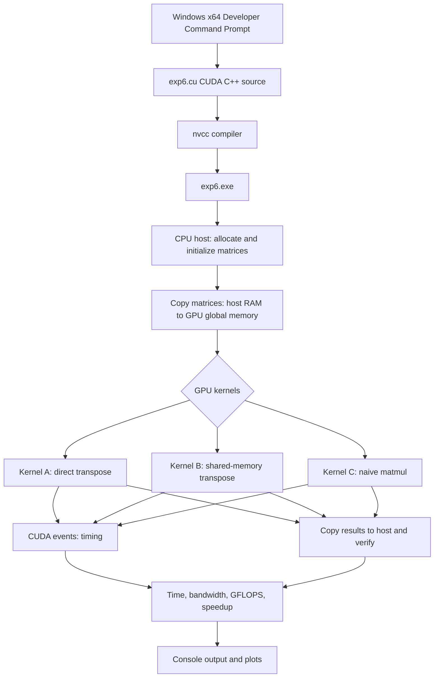
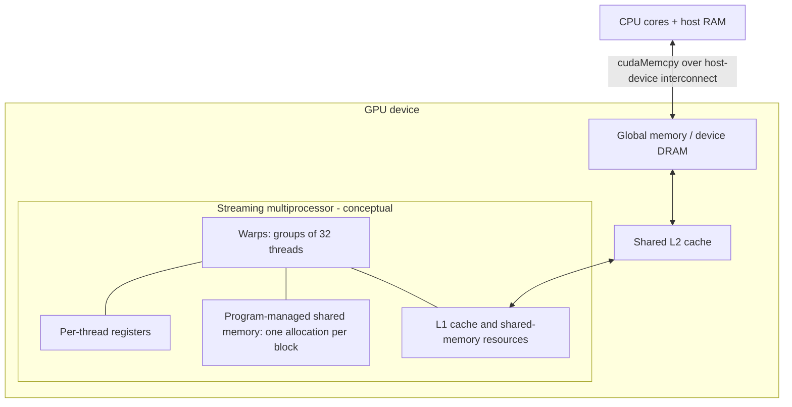
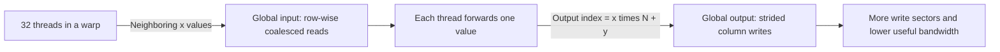
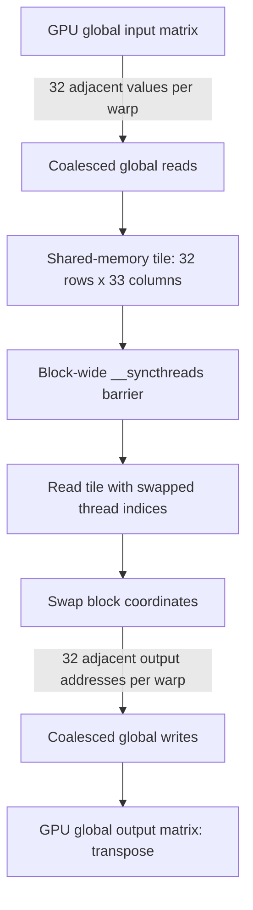
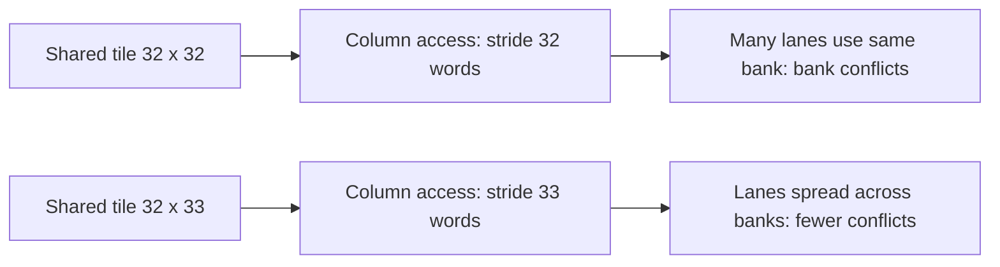
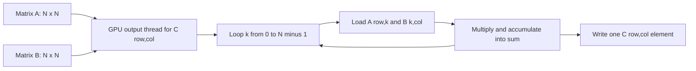
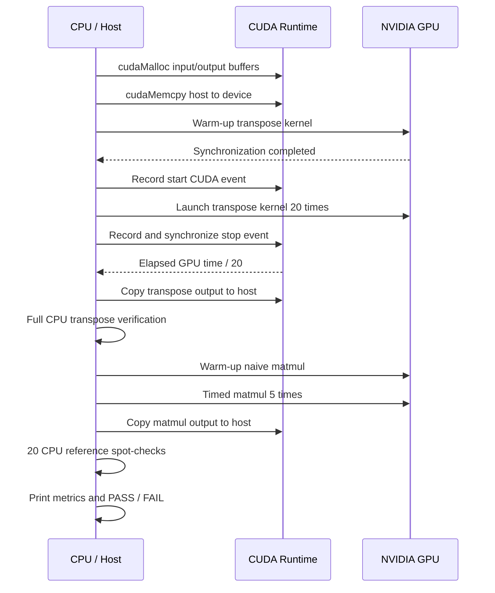
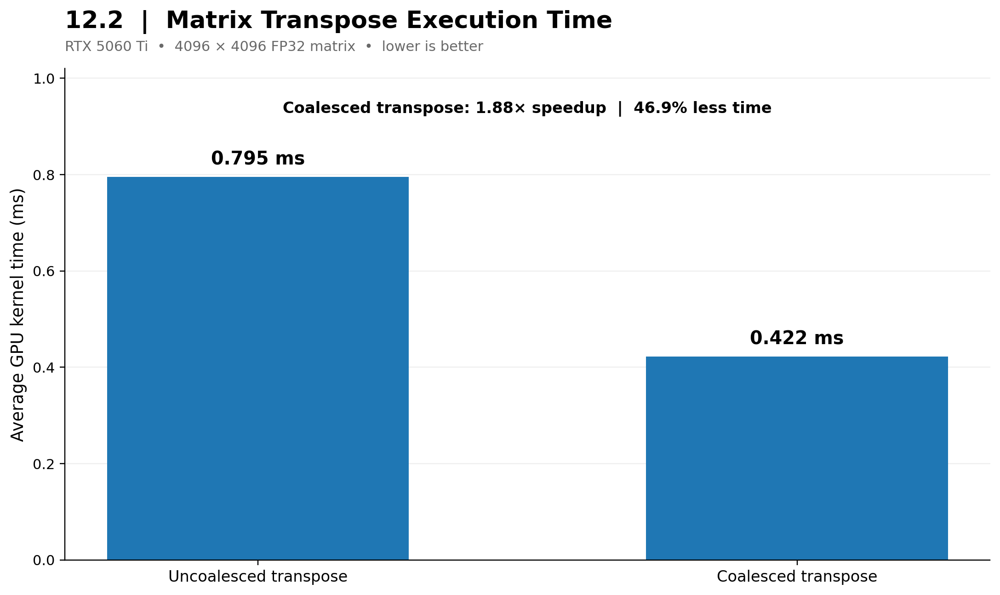
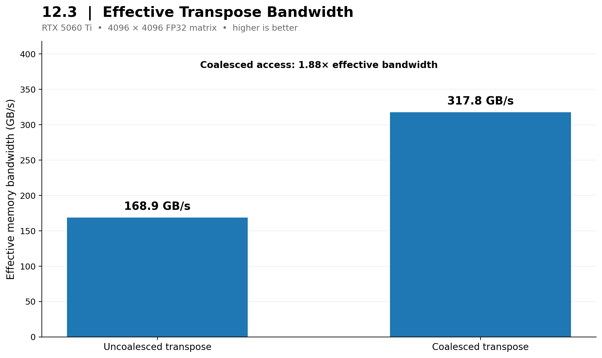
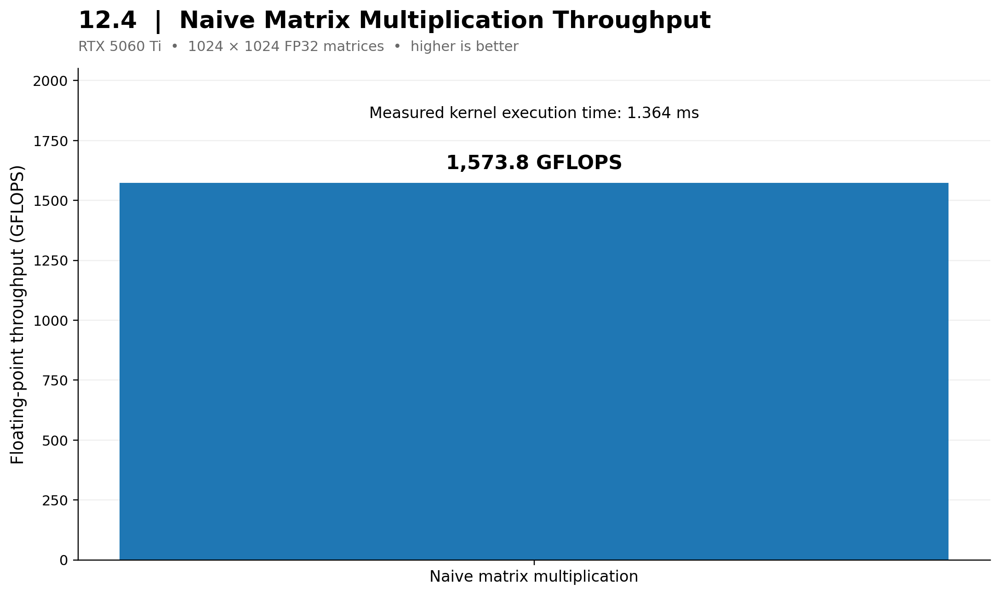

# CUDA Memory Optimization: Coalesced vs. Uncoalesced Access and Naive Matrix Multiplication

**Experiment 6 — Memory Systems and Synchronization | Parallel and GPU Computing**

A reproducible CUDA C/C++ laboratory study of how **global-memory access patterns** influence GPU execution time. The project compares a direct (uncoalesced-write) matrix transpose with a shared-memory, coalesced transpose; it also benchmarks naive matrix multiplication as a baseline for understanding data reuse and computational throughput.

> **Measured hardware:** NVIDIA GeForce RTX 5060 Ti (compute capability 12.0)  
> **Measured transpose improvement:** **1.88x speedup** (0.795 ms → 0.422 ms)  
> **Correctness:** All three kernels reported **PASS** on the recorded execution.  
> **Data provenance:** The numbers below come from one user-recorded successful Windows run. The repeated console text in the original transcript is not treated as a second independent trial.

## Table of contents

1. [Aim and learning objectives](#1-aim-and-learning-objectives)
2. [Project architecture](#2-project-architecture)
3. [CUDA execution and memory fundamentals](#3-cuda-execution-and-memory-fundamentals)
4. [Theory: memory coalescing](#4-theory-memory-coalescing)
5. [Kernel A: uncoalesced matrix transpose](#5-kernel-a-uncoalesced-matrix-transpose)
6. [Kernel B: coalesced matrix transpose](#6-kernel-b-coalesced-matrix-transpose)
7. [Why 32 by 33 shared-memory padding matters](#7-why-32-by-33-shared-memory-padding-matters)
8. [Kernel C: naive matrix multiplication](#8-kernel-c-naive-matrix-multiplication)
9. [Program workflow and implementation](#9-program-workflow-and-implementation)
10. [Hardware, software, setup, and execution](#10-hardware-software-setup-and-execution)
11. [Benchmark methodology and formulas](#11-benchmark-methodology-and-formulas)
12. [Actual observations and performance graphs](#12-actual-observations-and-performance-graphs)
13. [Performance analysis](#13-performance-analysis)
14. [Verification and limitations](#14-verification-and-limitations)
15. [Troubleshooting](#15-troubleshooting)
16. [Results and conclusion](#17-results-and-conclusion)

---

## 1. Aim and learning objectives

**Aim:** Investigate how the global-memory access pattern of a CUDA kernel affects performance by comparing uncoalesced and coalesced matrix transpose, then benchmark a naive matrix-multiplication kernel.

**Learning objectives:**

- Explain the relationship between threads, blocks, grids, and warps.
- Distinguish coalesced global-memory transactions from strided transactions.
- Implement a 2D direct matrix transpose and a shared-memory tiled transpose.
- Explain `__syncthreads()` and shared-memory bank conflicts.
- Implement naive matrix multiplication, assigning one output element to each GPU thread.
- Measure kernel-only runtime with CUDA events after a warm-up.
- Calculate effective memory bandwidth (GB/s), matrix multiplication throughput (GFLOPS), and speedup.
- Verify GPU results against CPU reference computations.

**Scope:** This lab is a CUDA microbenchmark and correctness study; it is not a neural-network experiment, a CPU-vs-GPU speedup comparison, or a claim about GPU peak performance.

## 2. Project architecture

### 2.1 End-to-end execution architecture



**Host versus device:** The CPU (host) prepares matrices, allocates buffers and initiates transfers; the NVIDIA GPU (device) executes massively parallel kernels. Device memory allocation uses `cudaMalloc`, data transfer uses `cudaMemcpy`, and GPU timing uses CUDA events.

### 2.2 CUDA device memory hierarchy (conceptual)



This is a **conceptual CUDA memory hierarchy**, not an exact floorplan or SM count for the RTX 5060 Ti. Global memory is large but comparatively high-latency; shared memory is much smaller, on-chip, and shared among threads within a block. Hardware caches also influence effective memory traffic.

### 2.3 Work decomposition

| Kernel | Matrix size (default) | Block dimensions | Grid dimensions | Logical threads | Work per thread |
|---|---:|---:|---:|---:|---|
| Direct transpose | 4096 x 4096 | 32 x 32 = 1,024 | 128 x 128 = 16,384 blocks | 16,777,216 | Read one float, write one float |
| Shared-memory transpose | 4096 x 4096 | 32 x 32 = 1,024 | 128 x 128 = 16,384 blocks | 16,777,216 | Load/stage one float, write one float |
| Naive matrix multiplication | 1024 x 1024 | 16 x 16 = 256 | 64 x 64 = 4,096 blocks | 1,048,576 | Compute one `C[row, col]` with a 1,024-step loop |

These are **logical CUDA threads launched**, not threads executing simultaneously. Hardware schedules blocks/warps over time. The code includes bounds checks for partial edge tiles.

## 3. CUDA execution and memory fundamentals

| Term | Explanation | Role in this project |
|---|---|---|
| Kernel | Function compiled to run on the GPU, declared `__global__` | `transposeNaive`, `transposeCoalesced`, `matMulNaive` |
| Thread | A single logical GPU worker | Handles one matrix output element |
| Warp | A group of 32 threads executing in the SIMT model | Unit whose memory accesses are coalesced into transactions |
| Block | Group of threads that can cooperate and synchronize | 32 x 32 transpose tiles; 16 x 16 matmul tiles |
| Grid | Collection of thread blocks launched for one kernel | Covers the entire matrix |
| Global memory | Device DRAM address space shared across the GPU | Input and output arrays (`d_in`, `d_out`, `dA`, `dB`, `dC`) |
| Shared memory | Small block-local, programmer-managed on-chip memory | Stages the transpose tile |
| Registers | Per-thread on-chip storage | Thread indices, accumulator `sum`, temporary values |
| `__syncthreads()` | Barrier for participating threads in the same block | Ensures tile loads finish before tile reads |
| CUDA events | GPU-stream timing mechanism | Measures average kernel execution time |

For a row-major `N x N` array of `float`, element `(row, col)` is located at `row * N + col`. Each `float` occupies 4 bytes. This indexing rule explains both transpose kernels.

## 4. Theory: memory coalescing

A warp contains 32 threads. When its threads request neighboring data, the GPU can satisfy the requests with relatively few aligned memory transactions. When each thread accesses distant addresses, the same warp may require many more transactions and transfer bytes that are not used by that instruction.

### 4.1 Simplified warp memory-address diagrams

**Coalesced pattern — neighboring addresses (one contiguous span):**

```text
Warp lanes:      T0   T1   T2   T3    ...   T31
Float indices:    0    1    2    3    ...    31
Byte offsets:     0    4    8   12    ...   124
                 +--------------------------------+
                 |        128 useful bytes        |
                 +--------------------------------+
```

**Uncoalesced pattern — stride of `N` floats:**

```text
Warp lanes:      T0       T1       T2       T3  ...  T31
Float indices:    0       N       2N       3N  ...  31N
Byte offsets:     0      4N       8N      12N  ... 124N
                 far-apart addresses; many memory sectors
```

For 32 threads each accessing a four-byte float, an aligned contiguous set of 128 bytes may use four 32-byte sectors. Thirty-two widely separated accesses may require up to 32 sectors. Exact transaction counts vary with alignment, cache state, and device architecture; these diagrams describe the underlying access pattern, not guaranteed transaction counts for every instruction.

### 4.2 Coalesced versus uncoalesced

| Aspect | Coalesced | Uncoalesced or strided |
|---|---|---|
| Neighboring lanes | Access nearby addresses | Access widely separated addresses |
| Global-memory transactions | Usually fewer | Potentially more |
| Useful bytes per transaction | Generally higher | Can be much lower |
| Effective bandwidth | Usually higher | Often lower |
| Source-code complexity | May need tiling or index changes | Usually simpler |
| Costs | Shared-memory access, synchronization, and extra indexing may be required | No shared-memory staging required |

**Important:** Coalescing describes a *warp memory instruction*, not an entire kernel. A kernel may have coalesced reads but uncoalesced writes.

## 5. Kernel A: uncoalesced matrix transpose

Matrix transpose exchanges row and column coordinates:

`out[col, row] = in[row, col]`

A simple transpose performs:

```cpp
int x = blockIdx.x * TILE + threadIdx.x;
int y = blockIdx.y * TILE + threadIdx.y;
if (x < N && y < N)
    out[x * N + y] = in[y * N + x];
```

### 5.1 Transpose example

```text
Input A (3 x 3):         Output A transpose:
1  2  3                 1  4  7
4  5  6        --->     2  5  8
7  8  9                 3  6  9
```

### 5.2 Global-memory traffic



Within a warp, `threadIdx.x` typically changes from 0 to 31 while `threadIdx.y` stays constant. The input index `y*N+x` increases by one float between lanes, but the output index `x*N+y` increases by `N` floats. With `N=4096`, adjacent lanes write **16,384 bytes apart**. This leads to inefficient global-memory write transactions.

**Advantages:** Minimal code and no block synchronization.  
**Disadvantage:** Strided writes often dominate memory-transaction overhead.

## 6. Kernel B: coalesced matrix transpose

The optimized kernel uses a **32 x 32 tile in shared memory**, performs a block-level barrier, and reorders output coordinates so neighboring lanes write neighboring global-memory elements.

```cpp
__shared__ float tile[TILE][TILE + 1];

int x = blockIdx.x * TILE + threadIdx.x;
int y = blockIdx.y * TILE + threadIdx.y;
if (x < N && y < N)
    tile[threadIdx.y][threadIdx.x] = in[y * N + x];

__syncthreads();

x = blockIdx.y * TILE + threadIdx.x;
y = blockIdx.x * TILE + threadIdx.y;
if (x < N && y < N)
    out[y * N + x] = tile[threadIdx.x][threadIdx.y];
```

### 6.1 Shared-memory tiling architecture



**Step-by-step operation:**

1. Each 32 x 32 block owns one square region of input.
2. Threads load consecutive global-memory floats into `tile[ty][tx]`.
3. `__syncthreads()` prevents early reads before the entire block finishes loading.
4. The output tile coordinates swap `blockIdx.x` and `blockIdx.y`.
5. Threads access `tile[tx][ty]` and write `out[y*N+x]`, preserving the transpose while making global writes contiguous.
6. The extra shared-memory column reduces bank conflicts during column-oriented shared-memory reads.

**Key concept:** This optimization does **not reduce the algorithm's logical data volume**: each matrix element is read once and written once. It reduces wasted global-memory transactions and adds a relatively inexpensive shared-memory reordering step.

### 6.2 Why this version takes less time in the recorded experiment

The direct kernel already performs coalesced reads, but it writes with a stride of 4096 floats. The optimized kernel makes both global reads and global writes coalesced. Although tiling introduces extra instructions, shared-memory accesses, and synchronization, the savings in global-memory traffic outweighed those overheads at `N=4096` on the measured RTX 5060 Ti.

**Observed:** 0.795 ms (direct) versus 0.422 ms (optimized), or **1.88x faster**. That is an experimental result, not a guaranteed acceleration on every GPU or matrix size.

## 7. Why 32 by 33 shared-memory padding matters

The code declares:

```cpp
__shared__ float tile[32][33];
```

The second dimension is **33**, not 32. GPU shared memory is divided into banks. For a common 32-bank layout, the bank index of a 32-bit array element can be conceptualized as:

`bank = (row * leading_dimension + column) mod 32`

With `tile[32][32]`, reading a column across 32 different rows causes a stride of 32 float words. All 32 lanes then target the same bank for different addresses: a 32-way bank conflict in the conventional layout.

With `tile[32][33]`, the stride becomes 33 float words:

`(row * 33 + column) mod 32 = (row + column) mod 32`

Different rows now map to different banks. The extra 32 floats cost only **128 additional bytes per block**, changing per-block shared-memory allocation from **4096 to 4224 bytes**.



**Why synchronization matters:** A thread may begin reading `tile[tx][ty]` that was written by another thread. The block barrier ensures those writes are completed and visible. `__syncthreads()` synchronizes threads in a block, not different blocks; no inter-block barrier is needed because each block uses its own independent tile.

## 8. Kernel C: naive matrix multiplication

For square matrices `A` and `B` of size `N x N`, each output element is:

`C[row, col] = sum(A[row, k] * B[k, col]) for k = 0 ... N-1`

```cpp
int row = blockIdx.y * BLK + threadIdx.y;
int col = blockIdx.x * BLK + threadIdx.x;
if (row < N && col < N) {
    float sum = 0.0f;
    for (int k = 0; k < N; ++k)
        sum += A[row * N + k] * B[k * N + col];
    C[row * N + col] = sum;
}
```

### 8.1 Computational architecture



The loop arrow represents repeated execution until all `N` products are accumulated; the write occurs after the loop finishes.

### 8.2 Why it is called naive

- Each thread owns one output element and performs `N` multiply-accumulate operations.
- The source code issues roughly **2N³ global load operations** across all output threads (`A` and `B` per inner iteration), though on-chip caches can satisfy some of these loads.
- Neighboring output columns often access consecutive values of `B` for a fixed `k`, which benefits memory access.
- The algorithm does not explicitly stage and reuse tiles of `A` and `B` in shared memory, so it misses an important optimization opportunity.
- It is a useful **baseline**. Tiled matmul can improve data reuse, but actual bottlenecks must be confirmed with a profiler; a naive kernel is not automatically memory-bound in every situation.

### 8.3 Operation count

Each of `N²` outputs needs approximately `N` multiplications and `N` additions: **2N³ floating-point operations**. For `N=1024`:

`2 * 1024^3 = 2,147,483,648 FLOPs`

This is an operation-count convention for benchmarking (the first accumulation need not be a separate add). The benchmark's printed **1573.8 GFLOPS** corresponds to approximately **1.574 TFLOPS** of measured naive-matmul throughput. It is **not** a GPU peak-throughput measurement.

## 9. Program workflow and implementation

### 9.1 Source structure

The single source file `exp6.cu` is organized into five sections, matching the supplied lab manual:

1. Headers, constants (`TILE=32`, `BLK=16`), and a CUDA API error-checking macro.
2. `transposeNaive` and `transposeCoalesced` kernels.
3. `matMulNaive` kernel.
4. Timing helper `timeTranspose`, CPU verification helpers `checkTranspose` and `checkMatMul`.
5. `main`: allocate, initialize, copy, launch, time, verify, print, free.

The working local implementation uses the corrected macro below. A variable named `e` inside the original macro conflicts with the CUDA event named `e` when the macro expands; the longer identifier avoids that issue.

```cpp
#define CHECK(call) do { \
    cudaError_t checkErr = (call); \
    if (checkErr != cudaSuccess) { \
        fprintf(stderr, "CUDA error: %s (%s:%d)\n", \
                cudaGetErrorString(checkErr), __FILE__, __LINE__); \
        exit(1); \
    } \
} while (0)
```

**Note:** Upload your **actual working** `exp6.cu` alongside this README. The packaged documentation does not pretend to include the original file from your laptop.

### 9.2 Host/device data and validation path



## 10. Hardware, software, setup, and execution

### 10.1 Recorded environment

| Component | Observed / used |
|---|---|
| GPU | NVIDIA GeForce RTX 5060 Ti |
| GPU compute capability | 12.0 |
| GPU memory reported by `nvidia-smi` | 16,311 MiB total |
| Operating system | Windows (native x64 build) |
| Compiler | NVIDIA CUDA Toolkit 13.4 (`nvcc`) |
| NVIDIA driver at test time | 610.88 |
| Reported CUDA user-mode driver version | 13.3 |
| Host compiler | Microsoft C++ compiler via x64 Native Tools Command Prompt |
| Data type | 32-bit `float` |
| Transpose size | `N=4096` |
| Matmul size | `N=1024` |

### 10.2 Verify the environment

Open the **x64 Native Tools Command Prompt** (not a normal PowerShell tab where `cl.exe` may not be on `PATH`):

```bat
nvidia-smi
nvcc --version
where cl
```

### 10.3 Compile for an RTX 5060 Ti

In the directory containing `exp6.cu`:

```bat
nvcc -O2 -gencode=arch=compute_120,code=sm_120 -o exp6.exe exp6.cu
```

The `sm_120` target produces native GPU code for compute capability 12.0. This was the successful compilation approach after a newer PTX version failed to load with the recorded driver. An updated supported NVIDIA driver may also resolve toolchain/driver compatibility problems; do not assume this specific flag is universally required.

### 10.4 Run

```bat
exp6.exe
```

Default sizes are transpose `4096 x 4096` and matmul `1024 x 1024`. Optional smaller run:

```bat
exp6.exe 2048 512
```

Use smaller sizes for a quick check, but retain the defaults for the primary benchmark. Numbers from different matrix sizes must not be mixed in one speedup comparison.

### 10.5 Linux / Google Colab (alternative)

Use a GPU runtime and upload or create `exp6.cu`:

```bash
!nvidia-smi
!nvcc --version
!nvcc -O2 -o exp6 exp6.cu
!./exp6
```

If compiling for an RTX 5060 Ti, the native architecture is `sm_120`; **do not force `sm_120` on a Tesla T4** (T4 uses a different architecture). Use the toolchain defaults or an appropriate architecture target for the GPU actually attached.

## 11. Benchmark methodology and formulas

### 11.1 Timing methodology

- Transpose kernels: one warm-up launch, then **20** repetitions timed using CUDA events; the average time per launch is printed.
- Naive matmul: one warm-up launch, then **5** repetitions timed using CUDA events; the average time per launch is printed.
- The input/output buffers are already on the GPU for kernel-only measurement. Host/device transfer time is **not** included in the reported kernel times.
- CUDA events are recorded around GPU work; synchronizing the stop event ensures completion before reading elapsed time.
- Verification runs after device-to-host copying and is **not** included in the timed kernel region.
- Run at least three independent program executions for stability analysis; the table here includes **one verified execution**, not three invented repeats.

### 11.2 Effective transpose bandwidth

For an `N x N` matrix of FP32 floats, one transpose reads `N² x 4` bytes and writes `N² x 4` bytes.

```text
Bytes moved logically = 2 x N² x 4
Effective GB/s = (2 x N² x 4) / (time_ms x 1,000,000)
```

For `N=4096`, logical data volume is:

`2 x 4096² x 4 = 134,217,728 bytes` (**134.218 MB decimal**, about **128 MiB**).

This is **effective bandwidth** based on useful bytes and time, not a measurement of actual DRAM transaction bytes. Because inefficient transactions move unnecessary bytes, the true physical traffic can be larger.

### 11.3 Matrix-multiplication throughput

```text
FLOPs = 2 x N³
GFLOPS = (2 x N³) / (time_ms x 1,000,000)
```

### 11.4 Speedup and relative time reduction

```text
Transpose speedup = Time(uncoalesced) / Time(coalesced)
Time reduction (%) = 100 x (1 - Time(coalesced)/Time(uncoalesced))
```

For the measured rounded times:

- `0.795 / 0.422 = 1.884` → **1.88x speedup**.
- `100 x (1 - 0.422/0.795) = 46.9%` → **approximately 46.9% less kernel time**.

The program calculates bandwidth/GFLOPS with its original higher-precision event times but prints the times to three decimal places. Recalculating from displayed rounded times may differ slightly from the printed metrics.

## 12. Actual observations and performance graphs

### 12.1 One successful recorded run

| Kernel | Matrix size | Average time | Effective bandwidth / throughput | Validation |
|---|---:|---:|---:|---|
| Uncoalesced transpose | 4096 x 4096 | **0.795 ms** | **168.9 GB/s** | PASS |
| Coalesced transpose | 4096 x 4096 | **0.422 ms** | **317.8 GB/s** | PASS |
| Naive matrix multiplication | 1024 x 1024 | **1.364 ms** | **1573.8 GFLOPS** | PASS |

**Transpose speedup:** `1.88x`. **GPU:** RTX 5060 Ti, compute capability `12.0`.
### 12.2 Execution Time Comparison



**Performance Analysis:**

- Uncoalesced Transpose Execution Time: **0.795 ms**
- Coalesced Transpose Execution Time: **0.422 ms**
- Achieved Speedup: **1.88x**

The coalesced transpose achieves better performance because adjacent GPU threads access contiguous global-memory locations.

The uncoalesced implementation performs strided memory writes, resulting in more memory transactions and reduced effective bandwidth.

The coalesced implementation uses shared-memory tiling to optimize global-memory access.

**Observation:** The coalesced implementation reduces execution time by approximately 46.9% compared with the uncoalesced implementation.

---

### 12.3 Effective Bandwidth Comparison



**Performance Analysis:**

- Uncoalesced Memory Bandwidth: **168.9 GB/s**
- Coalesced Memory Bandwidth: **317.8 GB/s**
- Bandwidth Improvement: **1.88x**

Memory coalescing allows neighboring GPU threads to access consecutive memory addresses, reducing the number of global-memory transactions.

The optimized transpose uses a 32 x 32 shared-memory tile with an additional padding column to reduce shared-memory bank conflicts.

**Observation:** The coalesced implementation achieves approximately 88.2% higher effective bandwidth than the uncoalesced implementation.

---

### 12.4 Naive Matrix Multiplication Throughput



**Performance Analysis:**

- Matrix Size: **1024 x 1024**
- Execution Time: **1.364 ms**
- Computational Throughput: **1573.8 GFLOPS**
- GPU: **NVIDIA GeForce RTX 5060 Ti**

The naive CUDA matrix multiplication kernel assigns one GPU thread to compute each output matrix element.

Each thread performs repeated global-memory accesses without using shared-memory tiling.

Although GPU parallelism provides substantial computational throughput, repeated global-memory accesses limit the efficiency of this implementation.

Further optimization can be achieved through:

1. Shared-memory tiling.
2. Global-memory access optimization.
3. Register-level data reuse.
4. Reduced redundant memory transfers.

**Observation:** The naive matrix multiplication achieves 1573.8 GFLOPS, providing a baseline for evaluating future optimized implementations.

**Note:** GFLOPS measures floating-point computational throughput, whereas GB/s measures memory bandwidth. These are different performance metrics and should not be compared directly.

### 12.5 Observation-data source

The supplied `results/run_01.csv` stores the values above. `scripts/plot_results.py` regenerates the figures from that CSV; it **does not run CUDA**, and it does not fabricate additional benchmark trials. To regenerate the charts, run `python -m pip install -r requirements.txt` and then `python scripts/plot_results.py` from the repository root.

## 13. Performance analysis

### 13.1 Why the coalesced transpose wins at N=4096

The direct transpose's reads are contiguous but its writes are strided by `N=4096` floats. Those writes use many global-memory sectors to commit only 4 bytes per lane. The optimized transpose first places data into a shared-memory tile and then writes the transposed tile to contiguous output locations. The trade-off is extra shared-memory traffic and a block barrier. At this size, reduced inefficient global writes outweighed the added overhead.

**Empirical support:** Bandwidth rose from **168.9 to 317.8 GB/s**, while transpose time fell from **0.795 to 0.422 ms**. This is consistent with more efficient global-memory transactions.

### 13.2 Why coalesced is not always faster

A coalesced tiled kernel is not automatically the best choice:

1. **Small workloads:** Shared-memory staging and synchronization overhead may be comparable to total computation time.
2. **Cache effects:** When data is already cached, naive accesses may be less costly than expected.
3. **Resource pressure:** Shared-memory consumption and register usage can reduce occupancy or block concurrency.
4. **Bank conflicts:** Poorly laid-out shared memory can serialize accesses and negate some of the gain.
5. **Thread/block layout:** Incorrect mapping of threads to memory addresses may defeat coalescing despite using tiles.
6. **Misalignment or irregular shapes:** Partial tiles and nonideal alignment may yield less efficient transactions.
7. **Measurement noise:** GPU clocks, power state, other workloads, and insufficient warm-up can change results.

An optimized kernel can therefore take **more time** than a naive kernel on a small or unsuitable test. Compare them under the **same input size**, with warm-up, repeated kernel-only measurements, validation, and ideally profiling.

### 13.3 Why the measured speedup is 1.88x rather than a larger theoretical factor

The simple 4-sector versus 32-sector comparison describes *one type of memory instruction*. Whole-kernel time also includes coalesced input reads, shared-memory tile transfers, a synchronization barrier, instructions, scheduling, caching, and global-memory subsystem behavior. Therefore, a reduced transaction count for the problematic writes does **not** translate directly into the same multiplicative reduction of entire kernel runtime.

### 13.4 How matmul differs from transpose

Transpose primarily rearranges data, with roughly two useful memory transfers per element and little arithmetic. Matrix multiplication performs about `2N³` floating-point operations and has different cache behavior and instruction throughput. Its **1.364 ms** should not be interpreted as inferior or superior to transpose solely because the raw elapsed time differs: the kernels perform different amounts of work.

### 13.5 What an advanced analysis can measure next

With NVIDIA Nsight Compute (when available), inspect achieved memory throughput, sector counts, occupancy, shared-memory bank conflicts, and instruction mix. These metrics help determine whether a suspected bottleneck is actually present. For comparable benchmarking, log GPU model, driver/toolkit, build flags, matrix sizes, repetitions, and environment load.

## 14. Verification and limitations

### 14.1 Correctness tests used in the provided manual

- **Transpose (both kernels):** Copies the output to CPU and checks **all** matrix elements using the exact condition `out[j*N+i] == in[i*N+j]`. This is suitable here because the initialization uses exactly representable small integer values stored as FP32.
- **Naive matrix multiplication:** Copies the output to CPU, selects **20** output positions, recomputes them using a CPU double-precision accumulation, and checks `abs(ref - GPU) <= 1e-3*abs(ref) + 1e-3`.
- All three checks reported **PASS** in the recorded run.

**Limitation:** The matmul checker examines 20 selected elements, not all `N²` outputs. A PASS is useful but does not mathematically prove that every result is correct. More robust validation would check additional or all elements on smaller matrices and report maximum absolute/relative error.

### 14.2 Benchmark limitations

- One independently confirmed execution is available in the supplied transcript.
- The sample numbers printed in the lab manual are illustrative results from another GPU, not measured results from this hardware.
- Results depend on matrix size, clocks, GPU load, driver, toolkit, optimization flags, and cache behavior.
- GPU kernel-only timings omit memory copies, allocation, CPU validation, and total application overhead.
- Bandwidth is computed from logical useful bytes, not captured physical DRAM traffic.
- A single naive-matmul GFLOPS point cannot establish the GPU's architectural peak or definite bottleneck.

## 15. Troubleshooting

| Problem | Likely cause | Appropriate remedy |
|---|---|---|
| `nvcc` not found | CUDA Toolkit missing or not in `PATH` | Verify `nvcc --version` and toolkit installation. |
| `cl.exe` not found | Microsoft C++ compiler environment not loaded | Use x64 Native Tools / Developer Command Prompt. |
| `cudaEventCreate` argument-type errors involving `e` | `CHECK` macro introduces a local `cudaError_t e` that shadows the event named `e` | Rename the macro's local error variable to `checkErr` throughout the macro. |
| `the provided PTX was compiled with an unsupported toolchain` | Driver/PTX compatibility mismatch | Use a supported driver/toolkit combination; on the tested RTX 5060 Ti, native `sm_120` compilation succeeded. |
| CUDA kernel reports FAIL | Incorrect row/column indices, output offset, partial tiles, or missing synchronization | Recheck `out[x*N+y]`, block swaps, bounds checks, and `__syncthreads()`. |
| Coalesced version shows little gain | Workload too small, resource overhead, bank conflicts, or noisy timing | Test default `N=4096`, use warm-up, repeat and profile. |
| Out of GPU memory | Requested matrices too large | Reduce transpose/matmul sizes, e.g. `exp6.exe 2048 512`. |
| Execution blocked by organizational policy | Windows application-control restriction | Request administrator approval or use an authorized GPU environment; do not disable organizational protections. |


## 17. Results and conclusion

### Recorded result

The optimized transpose required **0.422 ms**, whereas the direct transpose required **0.795 ms** for the same `4096 x 4096` input. This is a **1.88x speedup**, corresponding to roughly **46.9% lower transpose kernel time**. The effective bandwidth increased from **168.9 GB/s** to **317.8 GB/s**. The naive `1024 x 1024` matrix multiplication required **1.364 ms** and delivered **1573.8 GFLOPS**. All three kernels passed the implemented validation checks.

### Conclusion

**GPU performance depends not only on the number of operations, but also on how threads access memory.** A naive transpose incurs inefficient, strided global-memory writes. A shared-memory tiled transpose reorganizes the same elements to preserve coalesced global-memory reads and writes; 32 x 33 padding helps avoid shared-memory bank conflicts. On the recorded NVIDIA RTX 5060 Ti, these changes made the transpose faster without changing its mathematical result. Naive matrix multiplication provides a separate computation baseline and motivates shared-memory reuse as a future optimization.


### Repository layout

```text
cuda-memory-optimization/
|-- README.md                       # This technical explanation
|-- exp6.cu                         # Add your actual compiled CUDA source
|-- RESULTS/
|   |-- transpose_times.png
|   |-- transpose_bandwidth.png
|   `-- matmul_throughput.png
|   `-- run_01.csv                  # One observed benchmark run
|-- scripts/
|   `-- plot_results.py            # Regenerates plots from CSV
|-- requirements.txt                 # Chart-generation dependency
`-- .gitignore                       # Excludes local build artifacts
```

### Reproducibility note

The README's numeric results are tied to the recorded RTX 5060 Ti run and its matrix sizes. Run the program on your own machine before making any claim about your hardware. Preserve terminal output and label any future screenshots, timings, and benchmark repetitions accurately.
