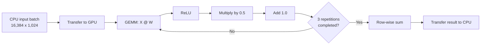
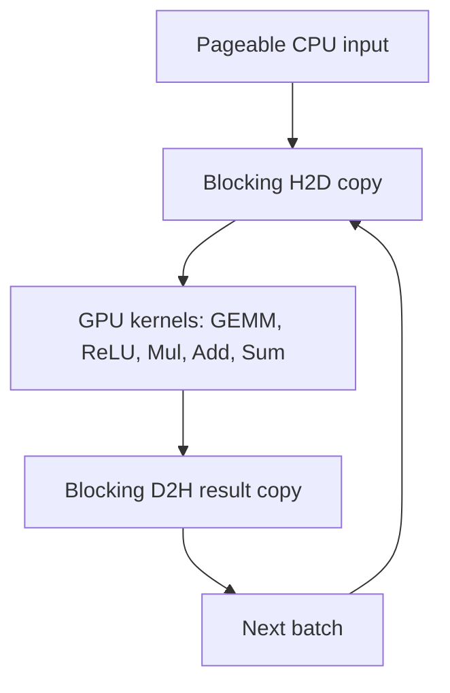
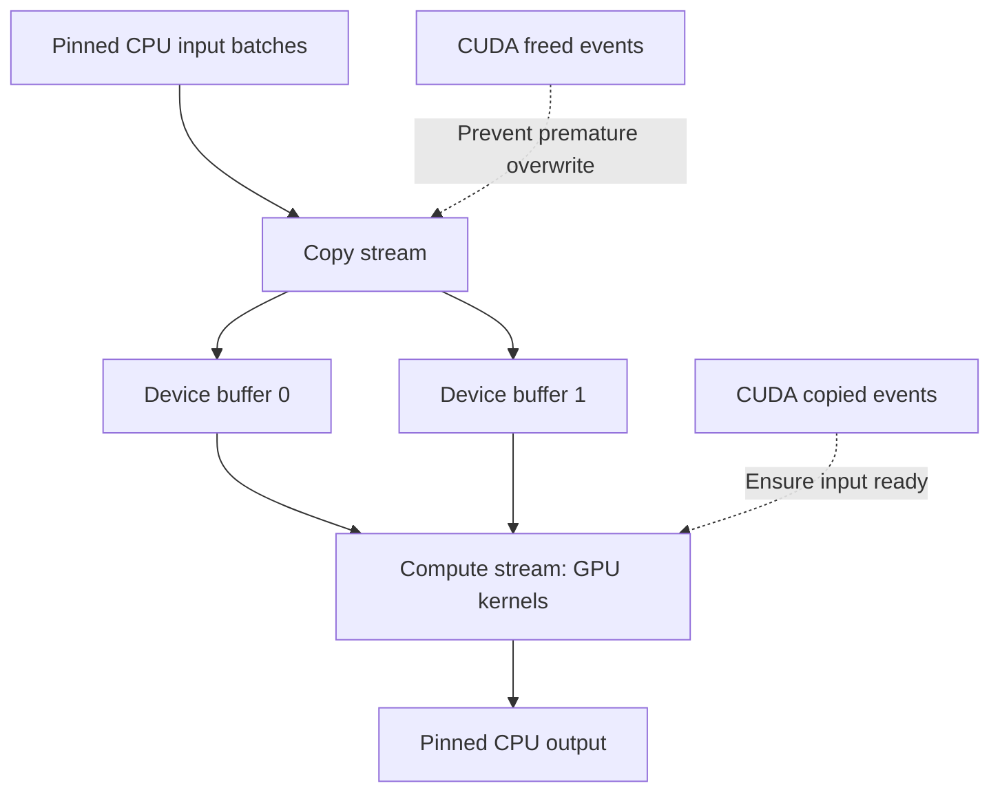

# Experiment 7 | Profiling and GPU Utilization

**Parallel and GPU Computing Laboratory**  
**KLE Technological University**  
**Execution environment:** Windows workstation | NVIDIA GeForce RTX 5060 Ti (16 GB) | PyTorch + CUDA

> **Objective:** Identify why a GPU workload is underutilized, locate the bottlenecks using profiling evidence, and improve execution by overlapping host-to-device transfers with GPU computation.

---

## Contents

1. [Executive overview](#1-executive-overview)
2. [Aim and learning outcomes](#2-aim-and-learning-outcomes)
3. [System and software requirements](#3-system-and-software-requirements)
4. [Theory and key concepts](#4-theory-and-key-concepts)
5. [Workload design](#5-workload-design)
6. [Baseline and optimized architectures](#6-baseline-and-optimized-architectures)
7. [Project structure](#7-project-structure)
8. [Reproduction instructions](#8-reproduction-instructions)
9. [Profiling methodology](#9-profiling-methodology)
10. [Experimental results](#10-experimental-results)
11. [Perfetto timeline evidence](#11-perfetto-timeline-evidence)
12. [Performance graphs](#12-performance-graphs)
13. [Arithmetic intensity and kernel classification](#13-arithmetic-intensity-and-kernel-classification)
14. [Bottlenecks and optimizations](#14-bottlenecks-and-optimizations)
15. [Correctness and limitations](#15-correctness-and-limitations)
16. [Conclusion](#16-conclusion)
17. [Viva questions and answers](#17-viva-questions-and-answers)
18. [Troubleshooting](#18-troubleshooting)
19. [References](#19-references)

---

## 1. Executive overview

A GPU can have substantial computing capability yet spend considerable time waiting for data transfers, host synchronization, or sequential dispatch. This experiment examines that problem using a repeatable PyTorch workload comprising matrix multiplication, element-wise operations, and a reduction.

Two implementations are evaluated:

| Aspect | Baseline implementation | Optimized implementation |
|---|---|---|
| Host memory | Pageable | Pinned (page-locked) |
| GPU execution | Default stream | Separate copy and compute streams |
| Host-to-device transfers | Blocking | Non-blocking |
| Device input buffers | Allocated as batches run | Two reusable buffers (double buffering) |
| Dependencies | Sequential ordering | CUDA events coordinate buffer use |
| Device-to-host result transfer | Blocking | Non-blocking copy into pinned output memory |
| Expected outcome | Copy and compute frequently wait on each other | Copy of the next batch can overlap current-batch computation |

**Evidence captured on the local workstation:** Both Perfetto traces were opened, and the expanded screenshots show a single GPU stream in the baseline versus distinct copy and compute streams in the optimized implementation. Quantitative speedup must be calculated from **local workstation measurements**, not from a different GPU.

## 2. Aim and learning outcomes

**Aim:** Profile a GPU workload to determine where execution time is lost and improve utilization by overlapping memory transfers with computation.

After the experiment, the student should be able to:

- Capture and read a GPU execution timeline.
- Recognize host-to-device (H2D), device-to-host (D2H), kernel activity, and GPU idle gaps.
- Distinguish between compute-bound and memory-bound kernels using arithmetic intensity.
- Explain pinned host memory, CUDA streams, events, and double buffering.
- Measure execution time, throughput, overlap, kernel-busy fraction, and GPU utilization.
- Verify that optimizing performance does not change the computation's results.

## 3. System and software requirements

### Local execution environment

| Component | Configuration |
|---|---|
| GPU | NVIDIA GeForce RTX 5060 Ti |
| GPU memory | 16 GB |
| Operating system | Windows |
| Python | 3.12 (used in the PowerShell commands) |
| GPU runtime | PyTorch with an NVIDIA CUDA-enabled build |
| GPU monitoring | `nvidia-smi` |
| GPU tracing | `torch.profiler` |
| Timeline viewer | [Perfetto](https://ui.perfetto.dev/) |
| Plotting | Matplotlib |

The installed NVIDIA driver, actual PyTorch version, and CUDA runtime version should be recorded from the machine rather than assumed:

```powershell
nvidia-smi
py -3.12 --version
py -3.12 -c "import torch; print('PyTorch:', torch.__version__); print('CUDA:', torch.version.cuda); print('Available:', torch.cuda.is_available()); print('GPU:', torch.cuda.get_device_name(0) if torch.cuda.is_available() else 'Not available')"
```

For a fresh machine, install Python and select the current **Windows / Pip / Python / CUDA** installation command from the [official PyTorch installer](https://pytorch.org/get-started/locally/). In particular, use a build that supports the RTX 5060 Ti; the older CUDA 12.1 wheel shown as an example in the manual is not an appropriate default for this newer GPU.

Install plotting support separately:

```powershell
py -3.12 -m pip install matplotlib
```

## 4. Theory and key concepts

### 4.1 GPU utilization

GPU utilization describes how actively the GPU is executing work during an observation period. A GPU can be reported as highly utilized without achieving peak computational efficiency, because activity and throughput are different measures.

**Two metrics used here must not be confused:**

- **`nvidia-smi` GPU-Util:** Driver-reported, sampled GPU activity; may include work from other applications and startup/shutdown intervals.
- **Profiler kernel-busy fraction:** The union of GPU kernel execution intervals divided by the measured trace window. This is a trace-based estimate, not the same as `nvidia-smi` GPU-Util.

### 4.2 Pageable and pinned host memory

**Pageable memory** is ordinary CPU memory managed by the operating system. Transferring it to a GPU may require intermediate staging.

**Pinned memory** is page-locked, helping the CUDA driver perform DMA transfers and enabling asynchronous transfer operations when supported by the GPU, driver, and execution configuration.

In PyTorch, the experiment uses `tensor.pin_memory()` together with `copy_(..., non_blocking=True)`.

### 4.3 CUDA streams

A CUDA stream is an ordered queue of GPU operations. Operations within one stream execute in stream order, while operations in different streams **may** execute concurrently when dependencies and hardware allow it.

### 4.4 Double buffering and CUDA events

Two reusable device buffers allow one batch to be copied while another is being processed. CUDA events preserve correctness:

- `copied[k]`: The input copy to buffer `k` has completed.
- `freed[k]`: Computation has finished reading buffer `k`, so it can be reused.

Removing these dependencies can cause operations to consume incomplete data or overwrite a buffer still in use.

### 4.5 Compute-bound versus memory-bound

Arithmetic intensity (AI) is the ratio of computation to data transferred:

$$
\mathrm{AI} = \frac{\text{Floating-point operations (FLOPs)}}{\text{Bytes moved from GPU memory}}
$$

The GPU's theoretical **ridge point** is:

$$
\mathrm{Ridge\ point} = \frac{\text{Peak floating-point performance (FLOP/s)}}{\text{Peak memory bandwidth (bytes/s)}}
$$

A kernel with sufficiently high AI tends to be compute-limited; one with low AI tends to be memory-bandwidth-limited. These are analytical expectations, not definitive measurements of bottlenecks on every workload.

## 5. Workload design

The workload processes a stream of input batches, transferring them from CPU memory to GPU memory, running several kernels, and transferring the reduced result back to the CPU.

### Default experimental parameters

| Parameter | Value |
|---|---:|
| Number of timed batches | 200 |
| Input tensor shape | 16,384 × 1,024 |
| Weight matrix shape | 1,024 × 1,024 |
| Data type | FP32 (4 bytes per element) |
| Input size per batch | 64 MiB (approximately 67.11 MB) |
| Repetitions per batch | 3 |
| Batches captured per profiler trace | 10 |
| Warm-up batches | 3 |
| Idle-gap reporting threshold | Greater than 50 microseconds |

### Processing pipeline



The input data and weights use fixed random seeds, making the two implementations comparable. The final output has one reduced value per input row.

## 6. Baseline and optimized architectures

### 6.1 Baseline: serial transfer and computation



The baseline uses one default CUDA stream and blocking copies. The CPU waits at batch boundaries, and GPU computation cannot hide the input transfer under useful work in this serial schedule.

**Simplified schedule** (conceptual; not measured timings):

```text
Time -->       Batch 0                         Batch 1
Copy engine:   [ H2D ]       [ D2H ]           [ H2D ]       [ D2H ]
Compute:               [ GPU kernels ]                [ GPU kernels ]
```

### 6.2 Optimized: two streams and double buffering



**Simplified schedule** (conceptual):

```text
Time -->       Stage 0             Stage 1             Stage 2
Copy stream:   [copy batch 0]      [copy batch 1]      [copy batch 2]
Compute:             [compute batch 0]   [compute batch 1]   [compute batch 2]
                          ^ overlap between next input copy and current compute
```

The copy engine and GPU compute engine can work concurrently if the device and driver permit it. Events preserve the required ordering without serializing the entire pipeline.

## 7. Project structure

The following is the recommended GitHub repository layout. The `.py` programs are those developed and executed locally during the experiment. Additional files are created by running the commands below.

```text
PGC_LAB7/
|
|-- README.md
|-- gpu_workload.py                 # Baseline and optimized workload
|-- analyze_trace.py                # Kernel intervals, overlap and idle gaps
|-- compare_performance.py          # 200-batch time and checksum comparison
|-- monitor_gpu.py                  # Samples nvidia-smi activity
|-- generate_graphs.py              # Runtime and throughput plots
|-- gpu_utilization_graphs.py       # Utilization and VRAM plots
|-- update_readme_results.py        # Populates this README from local files
|
|-- trace_baseline.json             # Baseline profiler output (after running)
|-- trace_optimized.json            # Optimized profiler output (after running)
|
`-- RESULTS/
    |-- baseline_timeline.png       # Actual local Perfetto screenshot
    |-- optimized_timeline.png      # Actual local Perfetto screenshot
    |-- performance_comparison.csv  # Measured local times and checksums
    |-- smi_baseline.csv            # Baseline nvidia-smi samples
    |-- smi_optimized.csv           # Optimized nvidia-smi samples
    |-- execution_time.png          # Generated locally
    |-- throughput.png              # Generated locally
    |-- gpu_utilization_timeline.png # Generated locally
    `-- gpu_memory_timeline.png     # Generated locally
```

**Repository note:** The accompanying package supplies this `README.md`, the two genuine Perfetto screenshot files, and `update_readme_results.py`. Copy them into the existing `PGC_LAB7` directory alongside your already-created Python scripts and measurement files.

## 8. Reproduction instructions

Run these commands from PowerShell on the Windows workstation.

### Step 1: Open the project directory

```powershell
cd "$HOME\Documents\PGC_LAB7"
```

### Step 2: Confirm CUDA works

```powershell
nvidia-smi
py -3.12 -c "import torch; print(torch.cuda.is_available()); print(torch.cuda.get_device_name(0) if torch.cuda.is_available() else 'CUDA unavailable')"
```

The Python output must show `True` and the NVIDIA GPU name.

### Step 3: Run baseline profiling

```powershell
py -3.12 .\gpu_workload.py --mode baseline --profile
```

Produces `trace_baseline.json` and displays total time, time per batch, throughput, and checksum.

### Step 4: Run optimized profiling

```powershell
py -3.12 .\gpu_workload.py --mode optimized --profile
```

Produces `trace_optimized.json` with the same workload settings.

### Step 5: Analyze each trace

```powershell
py -3.12 .\analyze_trace.py .\trace_baseline.json
py -3.12 .\analyze_trace.py .\trace_optimized.json
```

The custom local analyzer accepts one trace filename at a time. Its printed report heading may say **BASELINE** even when reading the optimized trace; the input filename determines which data is analyzed.

### Step 6: Collect directly comparable full-run timings

```powershell
py -3.12 .\compare_performance.py
```

Creates `RESULTS/performance_comparison.csv` using both modes under the same workload configuration.

### Step 7: Record sampled GPU utilization

```powershell
py -3.12 .\monitor_gpu.py
```

Creates `RESULTS/smi_baseline.csv` and `RESULTS/smi_optimized.csv`. Avoid running other GPU-intensive applications during the measurements.

### Step 8: Generate local performance graphs

```powershell
py -3.12 .\generate_graphs.py
py -3.12 .\gpu_utilization_graphs.py
```

### Step 9: Populate the tables in this README

```powershell
py -3.12 .\update_readme_results.py
```

The updater uses local CSV and JSON measurements, prints which inputs are missing, and replaces the **auto-generated results** section without inventing values.

### Step 10: Capture and inspect the traces

Open `trace_baseline.json` and `trace_optimized.json` separately in [Perfetto](https://ui.perfetto.dev/). Expand the CPU process and GPU stream rows, and zoom to a few batches. Save screenshots under `RESULTS/`.

## 9. Profiling methodology

1. **Warm up:** Run three unmeasured batches before timing, allowing initial CUDA setup, memory allocation, and library initialization.
2. **Time the full workload:** Execute 200 batches and synchronize the GPU before stopping the timer.
3. **Capture trace data:** Use `torch.profiler` for a smaller 10-batch window, exporting a Chrome-compatible JSON timeline.
4. **Identify kernels and copies:** Read `kernel`, `gpu_memcpy`, and `gpu_memset` events from the profiler trace.
5. **Compute metrics:** Merge overlapping intervals, calculate the captured time window, kernel-busy fraction, copy/compute overlap, and gaps longer than 50 microseconds.
6. **Sample GPU activity:** Log `nvidia-smi` utilization and memory usage during each run.
7. **Validate correctness:** Compare checksums from both implementations and investigate substantial differences.
8. **Repeat if necessary:** Rerun measurements after minimizing background GPU activity to assess variability.

### Performance equations

$$
\mathrm{Throughput} = \frac{\text{Number of batches}}{\text{Total elapsed time}}
$$

$$
\mathrm{Speedup} = \frac{T_{\mathrm{baseline}}}{T_{\mathrm{optimized}}}
$$

$$
\mathrm{Time\ reduction\ (\%)} = 100\times\frac{T_{\mathrm{baseline}}-T_{\mathrm{optimized}}}{T_{\mathrm{baseline}}}
$$

$$
\mathrm{Kernel\ busy\ fraction\ (\%)} = 100\times\frac{\text{Merged kernel-active time}}{\text{Trace window}}
$$

Overlapping memory-copy and kernel intervals are measured by the intersection of their merged time ranges; they are **not** inferred from the apparent total length of colored bars.

## 10. Experimental results

The tables below are reserved for **actual RTX 5060 Ti results**. They can be populated automatically using `update_readme_results.py` after copying the locally produced `RESULTS/performance_comparison.csv`, `RESULTS/smi_*.csv`, and `trace_*.json` files into this repository. No timings from other GPUs have been substituted.

<!-- AUTO_RESULTS_START -->
### Table 1. End-to-end performance (200 batches)

| Measurement | Baseline | Optimized | Change |
|---|---:|---:|---:|
| Total execution time (s) | Not recorded | Not recorded | Not recorded |
| Average time per batch (ms) | Not recorded | Not recorded | — |
| Throughput (batches/s) | Not recorded | Not recorded | Not recorded |
| Output checksum | Not recorded | Not recorded | Not recorded |

### Table 2. GPU profiling (10 batches)

| Measurement | Baseline | Optimized |
|---|---:|---:|
| Profiled window (ms) | Not recorded | Not recorded |
| Kernel busy time (ms) | Not recorded | Not recorded |
| Kernel busy fraction (%) | Not recorded | Not recorded |
| GPU copy / memset time (ms) | Not recorded | Not recorded |
| Copy/compute overlap (ms) | Not recorded | Not recorded |
| Idle gaps > 50 microseconds (count) | Not recorded | Not recorded |
| Total large-gap duration (ms) | Not recorded | Not recorded |

### Table 3. `nvidia-smi` monitoring

| Measurement | Baseline | Optimized |
|---|---:|---:|
| Mean sampled GPU-Util (%) | Not recorded | Not recorded |
| Maximum sampled GPU-Util (%) | Not recorded | Not recorded |
| Mean VRAM in use (MiB) | Not recorded | Not recorded |
| Number of utilization samples | Not recorded | Not recorded |

*All metrics above are read from local workstation files. The profiler
window (10 batches) is different from the full-runtime benchmark (200 batches).
Sampled `nvidia-smi` averages may include startup/shutdown intervals.*
<!-- AUTO_RESULTS_END -->

## 11. Perfetto timeline evidence

### 11.1 Baseline: one GPU stream


**Observation:** The expanded baseline trace shows a single GPU stream (`stream 7` in the captured screenshot), with memory-transfer activities interleaved with GPU kernel work. This is consistent with serial copy-and-compute scheduling.

### 11.2 Optimized: separate copy and compute streams


**Observation:** The optimized screenshot shows separate GPU stream tracks (`stream 29` and `stream 33` in this capture). Memory transfers appear on one track and computation kernels on another. The trace supports the use of multiple streams; the **amount of actual concurrency must be established from the analyzer's overlap measurement**.

**Important interpretation:** The visible Perfetto time ranges are captures of only part of the experiment and cannot by themselves establish the full 200-batch speedup.

## 12. Performance graphs

The local graph-generation scripts produce the following figures in `RESULTS/`. These are intentionally not populated with measurements from a different GPU.

<!-- AUTO_FIGURES_START -->
Add locally generated graph files to `RESULTS/`, then run `py -3.12 .\update_readme_results.py` to display them here. Expected filenames: `execution_time.png`, `throughput.png`, `gpu_utilization_timeline.png`, and `gpu_memory_timeline.png`.
<!-- AUTO_FIGURES_END -->

**Interpreting the figures:** Lower execution time and higher throughput indicate better end-to-end performance. Driver-sampled utilization and memory-use plots should be considered alongside profiler evidence, not as substitutes for it.

## 13. Arithmetic intensity and kernel classification

The following arithmetic-intensity estimates follow the **default tensor dimensions and simplified traffic model** in the lab manual. They are theoretical per-operation estimates, not direct DRAM counter measurements from the RTX 5060 Ti.

### GEMM (matrix multiplication)

With input dimensions `R = 16,384` rows and `N = 1,024` columns:

$$
\mathrm{FLOPs} \approx 2RN^2 = 2\times 16{,}384\times 1{,}024^2
\approx 34.36\times 10^9
$$

The idealized minimum data traffic is approximately 138 MB (reading the input and weights, writing the output):

$$
\mathrm{AI_{GEMM}} \approx \frac{34.36\times 10^9}{138\times 10^6}
\approx 249\ \mathrm{FLOP/byte}
$$

### Element-wise and reduction kernels

| Kernel / operation | Expected calls in 10 profiled batches | Approximate arithmetic intensity | Expected limiting factor |
|---|---:|---:|---|
| GEMM / cuBLAS or CUTLASS | 30 | 249 FLOP/byte | Compute-bound candidate |
| ReLU | 30 | 0.125 FLOP/byte | Memory-bound candidate |
| Multiply | 30 | 0.125 FLOP/byte | Memory-bound candidate |
| Add | 30 | 0.125 FLOP/byte | Memory-bound candidate |
| Row-wise sum reduction | 10 | 0.25 FLOP/byte | Memory-bound candidate |

The manual's **example** GPU has a ridge point of approximately 35 FLOP/byte. That example is **not** the measured ridge point of the RTX 5060 Ti. For a rigorous device-specific roofline conclusion, obtain this GPU's FP32 peak performance and memory bandwidth, calculate its ridge point, and ideally measure actual memory traffic.

**Kernel identification in this experiment:** GEMM may appear under `cutlass`, `sgemm`, `cublas`, or architecture-specific implementation names. Element-wise and reduction kernels commonly appear under PyTorch/ATen CUDA kernel names. Name-based classification is a hint; arithmetic intensity provides the justification.

## 14. Bottlenecks and optimizations

| Identified bottleneck | Evidence to examine | Optimization | Expected benefit |
|---|---|---|---|
| Pageable host memory | H2D copy names, transfer durations | Allocate pinned host batches using `.pin_memory()` | More efficient async transfer path |
| Serial copies and computation | Baseline timeline; little measured overlap | Separate copy and compute CUDA streams | Concurrent transfer/compute where supported |
| CPU waits at each output copy | Blocking `.cpu()` on every batch | Non-blocking D2H into pinned output tensor; synchronize at end | Less host-side serialization |
| Reusing a buffer before GPU work finishes | Cross-stream dependencies | Two buffers plus `copied` and `freed` CUDA events | Correctness without full-device synchronization at every batch |
| Multiple element-wise memory passes | ReLU, multiply, add kernels | Not optimized in this experiment; possible future kernel fusion | Reduced memory traffic and launches |

### What the timelines demonstrate

- **Baseline:** Data transfers and computation share a serial GPU execution path.
- **Optimized:** Data transfers and computation are assigned to separate GPU stream tracks.
- **Quantitative proof:** The local profiler's copy/compute overlap and idle-gap metrics determine whether scheduling differences translated into measurable overlap.

### Potential further optimization

Kernel fusion, tuning batch sizes, experimenting with different compute repetitions (`--reps 1` versus `--reps 8`), and reducing launch overhead could be investigated. These are **future improvements**, not results claimed in this experiment.

## 15. Correctness and limitations

### Correctness requirement

The baseline and optimized implementations must compute the same result for the same data. The program prints a checksum after summing the output values. Check for an exact match at the displayed precision or a suitably small floating-point tolerance.

Matching checksums provide useful validation, but do **not** prove every individual output element matches; a full element-wise comparison is stronger.

### Measurement limitations

1. **A profile is a sample:** The trace typically captures 10 batches; total runtime measures 200 batches. Do not equate those two time windows.
2. **Profiler overhead:** Capturing CPU/CUDA activity can affect timing; compare the separate full-workload measurements for speedup.
3. **WDDM and background applications:** Windows scheduling, driver mode, display activity, and other workloads can change performance and overlap.
4. **Sampled utilization is not occupancy:** `nvidia-smi` reports activity samples rather than SM occupancy, achieved FLOP/s, or execution efficiency.
5. **Kernel labels are analytical candidates:** A real roofline study needs device-specific hardware limits and memory-traffic counters.
6. **One test run is not a statistical benchmark:** Multiple repetitions with median/spread reporting give a more reliable result.

## 16. Conclusion

This experiment demonstrates a systematic GPU optimization workflow: **measure first, identify the bottleneck, change the execution schedule, and verify correctness**. The baseline workload uses pageable host memory and sequential memory transfers. The optimized version uses pinned memory, two CUDA streams, CUDA events, and double buffering to permit overlap between input transfers and GPU kernels.

The saved local Perfetto screenshots verify the change from a single GPU stream to distinct transfer and computation streams. The final numerical claims about throughput, utilization, overlap, idle gaps, and speedup should be taken from the **RTX 5060 Ti CSV and profiler traces** in Section 10. The checksum comparison confirms whether the optimization preserves the workload's reported result.

**Main lesson:** A faster GPU algorithm is not just one with faster kernels; it is also one that keeps the device supplied with work and avoids unnecessary synchronization.

## 17. Viva questions and answers

**Q1. Define GPU utilization. Why can `nvidia-smi` show 100% even if the GPU is not fully efficient?**  
GPU utilization indicates activity during the sampling period. A GPU can have one or more kernels running yet still achieve low occupancy or suboptimal arithmetic throughput. Activity is therefore not the same as peak efficiency.

**Q2. Why is pinned memory preferred to pageable memory for CPU-to-GPU transfers?**  
Pinned memory stays page-locked and supports more direct DMA transfers. It can also enable asynchronous transfers with `non_blocking=True` when supported by the execution setup.

**Q3. Why use two streams and two device buffers?**  
The copy stream can prepare the next input while the compute stream processes the current input. Separate buffers prevent the next copy from overwriting data still being consumed. CUDA events coordinate these dependencies.

**Q4. What are arithmetic intensity and the ridge point? Is GEMM always compute-bound?**  
Arithmetic intensity is FLOPs per byte transferred. The ridge point is peak FLOP/s divided by peak memory bandwidth. Large GEMM operations often have high intensity, but tiny matrices may instead be launch-bound or memory-bound.

**Q5. Why might measured speedup be smaller than the theoretical limit?**  
Some memory transfer and computation may not overlap due to dependencies or hardware constraints; unavoidable kernel time, synchronization overhead, memory bandwidth limits, and Windows GPU scheduling also restrict speedup.

**Q6. Why must the checksums match?**  
Optimization must preserve correct results. A program that runs faster but computes a different answer is not a valid optimization.

## 18. Troubleshooting

| Problem | Likely cause and action |
|---|---|
| `torch.cuda.is_available()` is `False` | Check NVIDIA driver and install a CUDA-enabled PyTorch build supporting the GPU. |
| Out-of-memory error | Rerun with a smaller input, e.g. `--rows 8192` or `--rows 4096`. |
| Trace has no kernel events / CUPTI warning | Close competing profilers, update driver, rerun the profile. |
| No observed overlap | Check pinned host memory, `non_blocking=True`, event dependencies, and Windows driver/scheduling behavior. |
| Optimized time is not better | Repeat with background GPU load minimized; compare identical batch settings and check pipeline dependencies. |
| `nvidia-smi` file has very few samples | Use a longer monitoring workload (e.g. `--batches 400` for both modes). |
| Checksums differ substantially | Verify event ordering, stream synchronization, buffers, and copied source code. |
| README images do not appear on GitHub | Confirm that the files exist in `RESULTS/` and that capitalization matches the relative Markdown paths. |

## 19. References

1. **KLE Technological University**, *Experiment 7: Profiling and GPU Utilization*, course laboratory manual (11 pages), Sections 1–9.
2. [PyTorch CUDA semantics: streams and synchronization](https://pytorch.org/docs/stable/notes/cuda.html).
3. [PyTorch Profiler documentation](https://pytorch.org/docs/stable/profiler.html).
4. [NVIDIA System Management Interface (`nvidia-smi`)](https://developer.nvidia.com/system-management-interface).
5. [Perfetto Trace Viewer](https://ui.perfetto.dev/).
6. [PyTorch installation guidance](https://pytorch.org/get-started/locally/).

---

*This README documents the local RTX 5060 Ti experiment. All quantitative local results should be generated and reported from the accompanying workstation's measurement files.*
