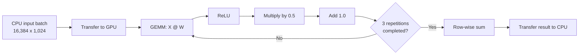
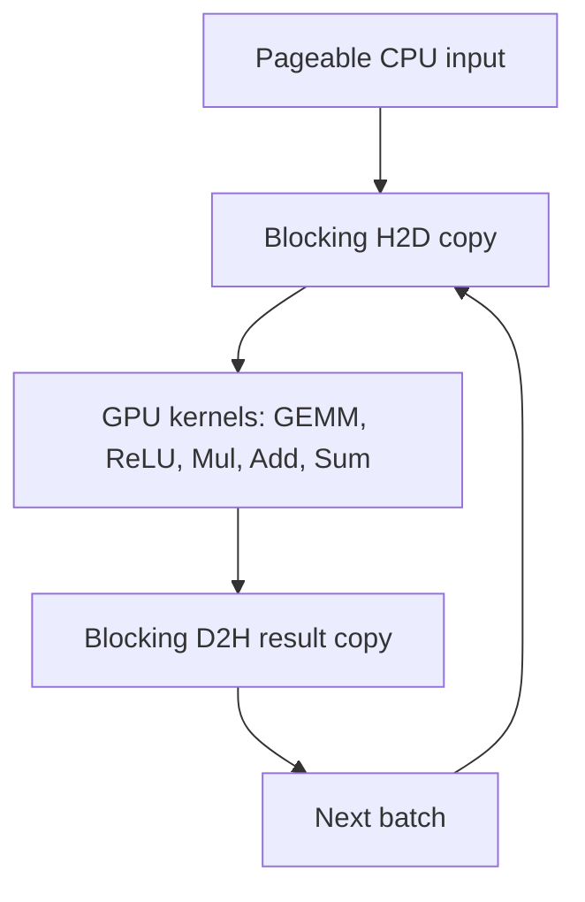
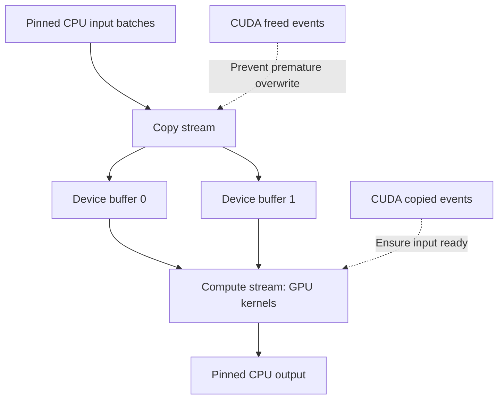
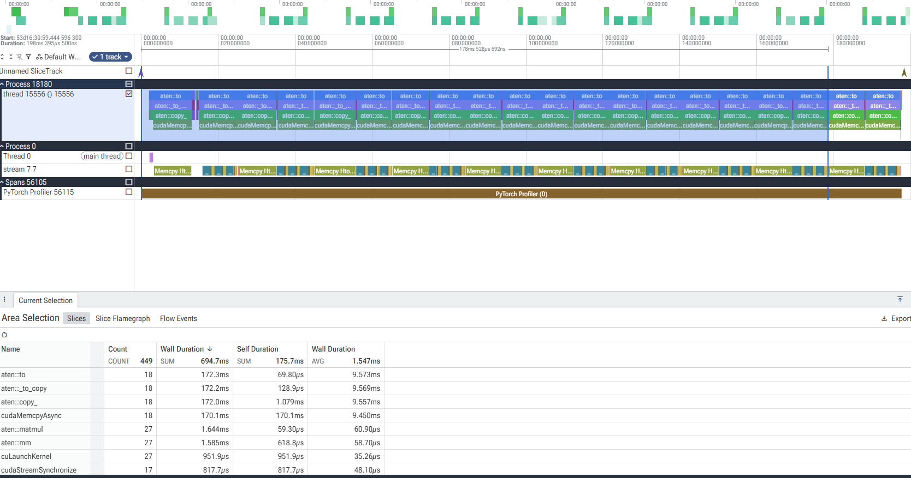
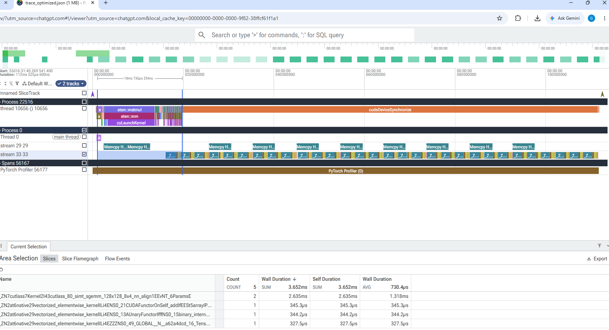
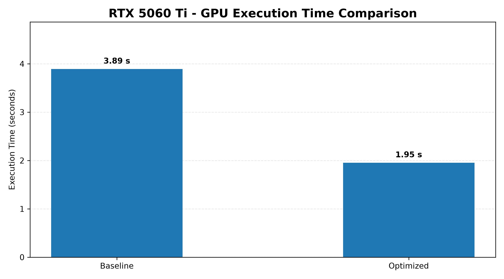
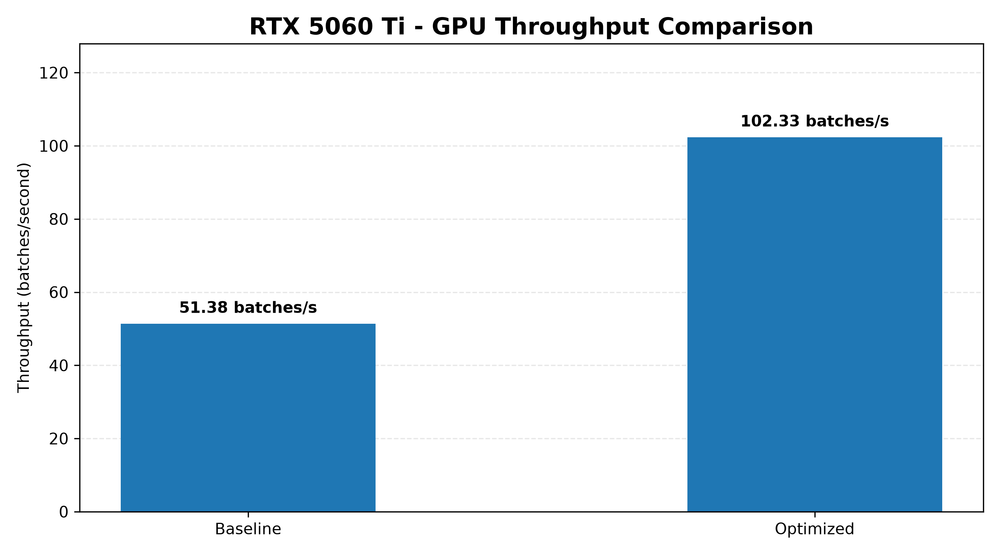
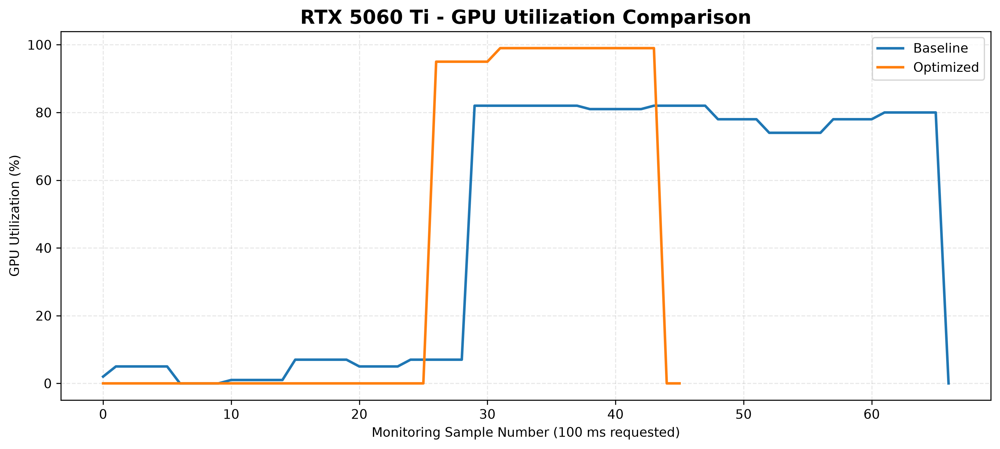
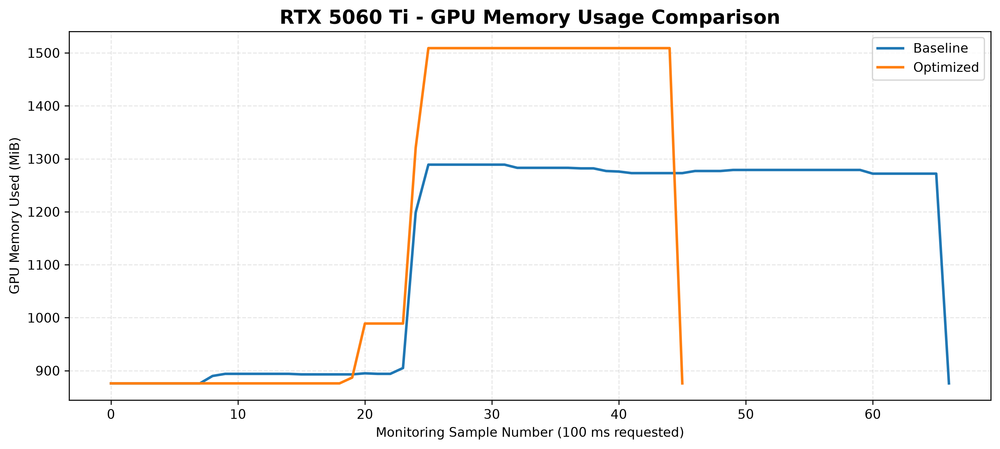

# Experiment 7 | Profiling and GPU Utilization


**Execution environment:** Windows workstation | NVIDIA GeForce RTX 5060 Ti (16 GB) | PyTorch + CUDA

> **Objective:** Identify why a GPU workload is underutilized, locate the bottlenecks using profiling evidence, and improve execution by overlapping host-to-device transfers with GPU computation.

---

## Contents

1. [Executive overview](#1-executive-overview)
2. [Aim and learning outcomes](#2-aim-and-learning-outcomes)
3. [System and software requirements](#3-system-and-software-requirements)
4. [Theory and key concepts](#4-theory-and-key-concepts)
5. [Workload design](#5-workload-design)
6. [Baseline and optimized architectures](#6-baseline-and-optimized-architectures)
7. [Actual project structure](#7-actual-project-structure)
8. [Reproduction instructions](#8-reproduction-instructions)
9. [Profiling methodology](#9-profiling-methodology)
10. [Experimental results](#10-experimental-results)
11. [Perfetto timeline evidence](#11-perfetto-timeline-evidence)
12. [Performance charts and raw evidence](#12-performance-charts-and-raw-evidence)
13. [Arithmetic intensity and kernel classification](#13-arithmetic-intensity-and-kernel-classification)
14. [Bottlenecks and optimizations](#14-bottlenecks-and-optimizations)
15. [Correctness and limitations](#15-correctness-and-limitations)
16. [Conclusion](#16-conclusion)
17. [Viva questions and answers](#17-viva-questions-and-answers)
18. [Troubleshooting](#18-troubleshooting)
19. [References](#19-references)

---

## 1. Executive overview

A GPU can have substantial computing capability yet spend considerable time waiting for data transfers, host synchronization, or sequential dispatch. This experiment examines that problem using a repeatable PyTorch workload comprising matrix multiplication, element-wise operations, and a reduction.

Two implementations are evaluated:

| Aspect | Baseline implementation | Optimized implementation |
|---|---|---|
| Host memory | Pageable | Pinned (page-locked) |
| GPU execution | Default stream | Separate copy and compute streams |
| Host-to-device transfers | Blocking | Non-blocking |
| Device input buffers | Allocated as batches run | Two reusable buffers (double buffering) |
| Dependencies | Sequential ordering | CUDA events coordinate buffer use |
| Device-to-host result transfer | Blocking | Non-blocking copy into pinned output memory |
| Expected outcome | Copy and compute frequently wait on each other | Copy of the next batch can overlap current-batch computation |

**Measured result on the local RTX 5060 Ti:** For 200 batches, execution time fell from **3.892 s** to **1.954 s**, a **1.99× speedup** (49.79% less time), with matching checksums. The 10-batch profiler traces confirm that copy/compute overlap increased from **0.000 ms** to **38.247 ms** and kernel busy fraction rose from **47.63%** to **85.61%**. The baseline screenshot shows one execution stream; the optimized screenshot shows distinct copy and compute streams.

## 2. Aim and learning outcomes

**Aim:** Profile a GPU workload to determine where execution time is lost and improve utilization by overlapping memory transfers with computation.

After the experiment, the student should be able to:

- Capture and read a GPU execution timeline.
- Recognize host-to-device (H2D), device-to-host (D2H), kernel activity, and GPU idle gaps.
- Distinguish between compute-bound and memory-bound kernels using arithmetic intensity.
- Explain pinned host memory, CUDA streams, events, and double buffering.
- Measure execution time, throughput, overlap, kernel-busy fraction, and GPU utilization.
- Verify that optimizing performance does not change the computation's results.

## 3. System and software requirements

### Local execution environment

| Component | Configuration |
|---|---|
| GPU | NVIDIA GeForce RTX 5060 Ti |
| GPU memory | 16 GB |
| Operating system | Windows |
| Python | 3.12 (used in the PowerShell commands) |
| GPU runtime | PyTorch with an NVIDIA CUDA-enabled build |
| GPU monitoring | `nvidia-smi` |
| GPU tracing | `torch.profiler` |
| Timeline viewer | [Perfetto](https://ui.perfetto.dev/) |
| Plotting | Matplotlib |

The installed NVIDIA driver, actual PyTorch version, and CUDA runtime version should be recorded from the machine rather than assumed:

```powershell
nvidia-smi
py -3.12 --version
py -3.12 -c "import torch; print('PyTorch:', torch.__version__); print('CUDA:', torch.version.cuda); print('Available:', torch.cuda.is_available()); print('GPU:', torch.cuda.get_device_name(0) if torch.cuda.is_available() else 'Not available')"
```

For a fresh machine, install Python and select the current **Windows / Pip / Python / CUDA** installation command from the [official PyTorch installer](https://pytorch.org/get-started/locally/). In particular, use a build that supports the RTX 5060 Ti; the older CUDA 12.1 wheel shown as an example in the manual is not an appropriate default for this newer GPU.

Install plotting support separately:

```powershell
py -3.12 -m pip install matplotlib
```

## 4. Theory and key concepts

### 4.1 GPU utilization

GPU utilization describes how actively the GPU is executing work during an observation period. A GPU can be reported as highly utilized without achieving peak computational efficiency, because activity and throughput are different measures.

**Two metrics used here must not be confused:**

- **`nvidia-smi` GPU-Util:** Driver-reported, sampled GPU activity; may include work from other applications and startup/shutdown intervals.
- **Profiler kernel-busy fraction:** The union of GPU kernel execution intervals divided by the measured trace window. This is a trace-based estimate, not the same as `nvidia-smi` GPU-Util.

### 4.2 Pageable and pinned host memory

**Pageable memory** is ordinary CPU memory managed by the operating system. Transferring it to a GPU may require intermediate staging.

**Pinned memory** is page-locked, helping the CUDA driver perform DMA transfers and enabling asynchronous transfer operations when supported by the GPU, driver, and execution configuration.

In PyTorch, the experiment uses `tensor.pin_memory()` together with `copy_(..., non_blocking=True)`.

### 4.3 CUDA streams

A CUDA stream is an ordered queue of GPU operations. Operations within one stream execute in stream order, while operations in different streams **may** execute concurrently when dependencies and hardware allow it.

### 4.4 Double buffering and CUDA events

Two reusable device buffers allow one batch to be copied while another is being processed. CUDA events preserve correctness:

- `copied[k]`: The input copy to buffer `k` has completed.
- `freed[k]`: Computation has finished reading buffer `k`, so it can be reused.

Removing these dependencies can cause operations to consume incomplete data or overwrite a buffer still in use.

### 4.5 Compute-bound versus memory-bound

Arithmetic intensity (AI) is the ratio of computation to data transferred:

$$
\mathrm{AI} = \frac{\text{Floating-point operations (FLOPs)}}{\text{Bytes moved from GPU memory}}
$$

The GPU's theoretical **ridge point** is:

$$
\mathrm{Ridge\ point} = \frac{\text{Peak floating-point performance (FLOP/s)}}{\text{Peak memory bandwidth (bytes/s)}}
$$

A kernel with sufficiently high AI tends to be compute-limited; one with low AI tends to be memory-bandwidth-limited. These are analytical expectations, not definitive measurements of bottlenecks on every workload.

## 5. Workload design

The workload processes a stream of input batches, transferring them from CPU memory to GPU memory, running several kernels, and transferring the reduced result back to the CPU.

### Default experimental parameters

| Parameter | Value |
|---|---:|
| Number of timed batches | 200 |
| Input tensor shape | 16,384 × 1,024 |
| Weight matrix shape | 1,024 × 1,024 |
| Data type | FP32 (4 bytes per element) |
| Input size per batch | 64 MiB (approximately 67.11 MB) |
| Repetitions per batch | 3 |
| Batches captured per profiler trace | 10 |
| Warm-up batches | 3 |
| Idle-gap reporting threshold | Greater than 50 microseconds |

### Processing pipeline



The input data and weights use fixed random seeds, making the two implementations comparable. The final output has one reduced value per input row.

## 6. Baseline and optimized architectures

### 6.1 Baseline: serial transfer and computation



The baseline uses one default CUDA stream and blocking copies. The CPU waits at batch boundaries, and GPU computation cannot hide the input transfer under useful work in this serial schedule.

**Simplified schedule** (conceptual; not measured timings):

```text
Time -->       Batch 0                         Batch 1
Copy engine:   [ H2D ]       [ D2H ]           [ H2D ]       [ D2H ]
Compute:               [ GPU kernels ]                [ GPU kernels ]
```

### 6.2 Optimized: two streams and double buffering



**Simplified schedule** (conceptual):

```text
Time -->       Stage 0             Stage 1             Stage 2
Copy stream:   [copy batch 0]      [copy batch 1]      [copy batch 2]
Compute:             [compute batch 0]   [compute batch 1]   [compute batch 2]
                          ^ overlap between next input copy and current compute
```

The copy engine and GPU compute engine can work concurrently if the device and driver permit it. Events preserve the required ordering without serializing the entire pipeline.

## 7. Actual project structure

This repository layout is taken directly from the uploaded Windows `PGC_LAB7` folder. Image references are deliberately written with the **exact existing filenames**, including the two `.png.png` timeline files.

```text
PGC_LAB7/
|-- README.md
|-- gpu_workload.py
|-- analyze_trace.py
|-- compare_performance.py
|-- monitor_gpu.py
|-- generate_graphs.py
|-- gpu_utilization_graphs.py
|-- trace_baseline.json
|-- trace_optimized.json
`-- RESULTS/
    |-- performance_comparison.csv
    |-- smi_baseline.csv
    |-- smi_optimized.csv
    |-- profiler_comparison.csv           # Added: derived from JSON traces
    |-- kernel_classification.csv          # Added: per-kernel classification
    |-- baseline_timeline.png.png
    |-- optimized_timeline.png.png
    |-- execution_time.png
    |-- throughput.png
    |-- gpu_utilization_timeline.png
    |-- gpu_memory_timeline.png
    |-- kernel_busy_fraction.png           # Added: trace analysis graph
    |-- copy_compute_overlap.png           # Added: trace analysis graph
    |-- gpu_idle_gap_time.png              # Added: trace analysis graph
    |-- Screenshot 2026-11-24 103913.png
    |-- Screenshot 2026-11-24 103929.png
    |-- Screenshot 2026-11-24 103956.png
    |-- Screenshot 2026-11-24 104013.png
    |-- Screenshot 2026-11-24 104031.png
    |-- Screenshot 2026-11-24 104052.png
    `-- Screenshot 2026-11-24 104106.png
```

### Source files

| File | Role |
|---|---|
| [`gpu_workload.py`](gpu_workload.py) | Baseline and optimized GPU workloads, timing, optional PyTorch profiling |
| [`analyze_trace.py`](analyze_trace.py) | Merges GPU intervals; reports kernel activity, overlap, and idle gaps |
| [`compare_performance.py`](compare_performance.py) | Runs both workloads and exports end-to-end performance CSV |
| [`monitor_gpu.py`](monitor_gpu.py) | Records `nvidia-smi` utilization and memory samples |
| [`generate_graphs.py`](generate_graphs.py) | Creates execution-time and throughput charts |
| [`gpu_utilization_graphs.py`](gpu_utilization_graphs.py) | Creates sampled GPU-utilization and memory-use charts |

All file links in this README are relative to `README.md` at the repository root. Upload the **entire `RESULTS/` folder** to GitHub to display the images and preserve the data evidence.

## 8. Reproduction instructions

Run these commands from PowerShell on the Windows workstation.

### Step 1: Open the project directory

```powershell
cd "$HOME\Documents\PGC_LAB7"
```

### Step 2: Confirm CUDA works

```powershell
nvidia-smi
py -3.12 -c "import torch; print(torch.cuda.is_available()); print(torch.cuda.get_device_name(0) if torch.cuda.is_available() else 'CUDA unavailable')"
```

The Python output must show `True` and the NVIDIA GPU name.

### Step 3: Run baseline profiling

```powershell
py -3.12 .\gpu_workload.py --mode baseline --profile
```

Produces `trace_baseline.json` and displays total time, time per batch, throughput, and checksum.

### Step 4: Run optimized profiling

```powershell
py -3.12 .\gpu_workload.py --mode optimized --profile
```

Produces `trace_optimized.json` with the same workload settings.

### Step 5: Analyze each trace

```powershell
py -3.12 .\analyze_trace.py .\trace_baseline.json
py -3.12 .\analyze_trace.py .\trace_optimized.json
```

The custom local analyzer accepts one trace filename at a time. Its printed report heading may say **BASELINE** even when reading the optimized trace; the input filename determines which data is analyzed.

### Step 6: Collect directly comparable full-run timings

```powershell
py -3.12 .\compare_performance.py
```

Creates `RESULTS/performance_comparison.csv` using both modes under the same workload configuration.

### Step 7: Record sampled GPU utilization

```powershell
py -3.12 .\monitor_gpu.py
```

Creates `RESULTS/smi_baseline.csv` and `RESULTS/smi_optimized.csv`. Avoid running other GPU-intensive applications during the measurements.

### Step 8: Generate local performance graphs

```powershell
py -3.12 .\generate_graphs.py
py -3.12 .\gpu_utilization_graphs.py
```

### Step 9: Capture and inspect the traces

Open `trace_baseline.json` and `trace_optimized.json` separately in [Perfetto](https://ui.perfetto.dev/). Expand the CPU process and GPU stream rows, and zoom to a few batches. Save screenshots under `RESULTS/`.

## 9. Profiling methodology

1. **Warm up:** Run three unmeasured batches before timing, allowing initial CUDA setup, memory allocation, and library initialization.
2. **Time the full workload:** Execute 200 batches and synchronize the GPU before stopping the timer.
3. **Capture trace data:** Use `torch.profiler` for a smaller 10-batch window, exporting a Chrome-compatible JSON timeline.
4. **Identify kernels and copies:** Read `kernel`, `gpu_memcpy`, and `gpu_memset` events from the profiler trace.
5. **Compute metrics:** Merge overlapping intervals, calculate the captured time window, kernel-busy fraction, copy/compute overlap, and gaps longer than 50 microseconds.
6. **Sample GPU activity:** Log `nvidia-smi` utilization and memory usage during each run.
7. **Validate correctness:** Compare checksums from both implementations and investigate substantial differences.
8. **Repeat if necessary:** Rerun measurements after minimizing background GPU activity to assess variability.

### Performance equations

$$
\mathrm{Throughput} = \frac{\text{Number of batches}}{\text{Total elapsed time}}
$$

$$
\mathrm{Speedup} = \frac{T_{\mathrm{baseline}}}{T_{\mathrm{optimized}}}
$$

$$
\mathrm{Time\ reduction\ (\%)} = 100\times\frac{T_{\mathrm{baseline}}-T_{\mathrm{optimized}}}{T_{\mathrm{baseline}}}
$$

$$
\mathrm{Kernel\ busy\ fraction\ (\%)} = 100\times\frac{\text{Merged kernel-active time}}{\text{Trace window}}
$$

Overlapping memory-copy and kernel intervals are measured by the intersection of their merged time ranges; they are **not** inferred from the apparent total length of colored bars.

## 10. Experimental results

**All results in this section come from the uploaded RTX 5060 Ti project files.** Full-run timing values were read from [`RESULTS/performance_comparison.csv`](RESULTS/performance_comparison.csv), trace metrics were independently calculated from [`trace_baseline.json`](trace_baseline.json) and [`trace_optimized.json`](trace_optimized.json), and monitoring values from the two `smi_*.csv` logs. The traces capture **10 batches**, while full-run timing captures **200 batches**; these are separate measurements.

### Table 1. End-to-end performance (200 batches)

| Measurement | Baseline | Optimized | Interpretation |
|---|---:|---:|---|
| GPU | RTX 5060 Ti | RTX 5060 Ti | Same local hardware |
| Total execution time | **3.892 s** | **1.954 s** | **1.99× speedup** |
| Average time per batch (from total time) | 19.46 ms | 9.77 ms | Lower is better |
| Throughput | 51.38 batches/s | 102.33 batches/s | **99.16% increase** |
| Time reduction | — | **49.79%** | 200-batch run |
| Checksum | `4.198830e+09` | `4.198830e+09` | **MATCH** at printed precision |

**Computation:**

$$
\mathrm{Speedup}=\frac{3.892}{1.954}\approx 1.99\times
$$

$$
\mathrm{Time\ reduction}=\frac{3.892-1.954}{3.892}\times 100\approx 49.79\%
$$

### Table 2. GPU profiling (10 batches)

| Measurement | Baseline | Optimized | Change |
|---|---:|---:|---|
| Profiled window | 194.092 ms | 109.059 ms | 43.81% shorter |
| GPU kernel busy time | 92.445 ms | 93.369 ms | Individual kernel work remains comparable |
| Kernel busy fraction | **47.63%** | **85.61%** | **+37.98 percentage points** |
| GPU copy time (merged intervals) | 95.841 ms | 49.875 ms | 47.96% shorter |
| Copy/compute overlap | 0.000 ms | **38.247 ms** | Overlap achieved |
| Kernel idle gaps > 50 µs | 9 | 9 | Count remains 9; durations shrink |
| Sum of gaps > 50 µs | 88.613 ms | **1.526 ms** | 98.28% reduction |

**Key observation:** The optimized trace still has **9 gaps longer than 50 µs**. It would be incorrect to claim that every gap was eliminated; instead, their combined duration fell from 88.613 ms to 1.526 ms. The GPU kernel active time is similar across modes, but the total window is shorter because copy and computation overlap. See the derived [`profiler_comparison.csv`](RESULTS/profiler_comparison.csv).

### Table 3. `nvidia-smi` monitoring

| Measurement | Baseline | Optimized |
|---|---:|---:|
| Mean sampled GPU utilization | 45.81% | 38.30% |
| Peak sampled GPU utilization | 82% | 99% |
| Minimum sampled GPU utilization | 0% | 0% |
| Mean GPU memory in use | 1131.97 MiB | 1170.96 MiB |
| Peak GPU memory in use | 1289 MiB | 1509 MiB |
| Logged samples | 67 | 46 |

**Sampling caveat:** The optimized log has fewer samples (46 versus 67) because its run was shorter. Both logs include startup and shutdown periods with little GPU activity; the means are therefore **not normalized to the active compute interval**. The raw `nvidia-smi` average is lower for the optimized run (38.30% versus 45.81%), even though its **peak sampled activity is higher** (99% versus 82%) and its **trace-based kernel busy fraction is substantially higher**. This is a sampling-window effect to discuss, not a reason to replace the measured values.

**Raw evidence:** [`performance_comparison.csv`](RESULTS/performance_comparison.csv) · [`smi_baseline.csv`](RESULTS/smi_baseline.csv) · [`smi_optimized.csv`](RESULTS/smi_optimized.csv) · [`profiler_comparison.csv`](RESULTS/profiler_comparison.csv).

## 11. Perfetto timeline evidence

The following **real local workstation traces** were opened in [Perfetto](https://ui.perfetto.dev/). The screenshots show CPU launch activity, GPU copy tracks, and GPU kernel tracks on the RTX 5060 Ti. Their existing filenames end in `.png.png`; the paths below match them exactly.

### 11.1 Baseline timeline: single GPU stream



*Figure 1. Baseline Perfetto timeline, obtained from [`trace_baseline.json`](trace_baseline.json).* The captured GPU work is scheduled on a single stream. Transfers and kernels do not overlap; the profiler measured **0.000 ms overlap** and **88.613 ms of large kernel gaps**.

### 11.2 Optimized timeline: two streams



*Figure 2. Optimized Perfetto timeline, obtained from [`trace_optimized.json`](trace_optimized.json).* Separate copy and compute tracks are visible. CUDA events coordinate double buffering, allowing GPU copies to overlap kernel work. The measured overlap is **38.247 ms**.

### 11.3 How to inspect the traces

1. Open [Perfetto Trace Viewer](https://ui.perfetto.dev/).
2. Load either [`trace_baseline.json`](trace_baseline.json) or [`trace_optimized.json`](trace_optimized.json).
3. Expand the process and stream tracks, then zoom into successive batch copies and kernels.
4. Compare the organization of `Memcpy HtoD` events against CUDA kernel events; use the profiler summary for numerical proof of overlap.

The visible Perfetto windows are **10-batch profiling captures**, not full 200-batch execution timing. Kernel busy fraction is not interchangeable with `nvidia-smi` GPU-utilization samples.

## 12. Performance charts and raw evidence

### 12.1 End-to-end runtime and throughput



*Figure 3. Total 200-batch execution time — lower is better (3.892 s versus 1.954 s).*



*Figure 4. Throughput — higher is better (51.38 versus 102.33 batches/s).*

### 12.2 GPU activity and memory usage (sampled)



*Figure 5. `nvidia-smi` GPU utilization. The x-axis represents successive monitor samples, **not synchronized elapsed time**. Different run lengths and startup/shutdown samples affect averages.*



*Figure 6. Device memory use sampled by `nvidia-smi`. Pinned host memory resides on the CPU; a higher device-memory reading does not by itself measure pinned host allocation.*


**Performance verification screenshot:**


**Reproducible datasets:** The complete observation data are included under [`RESULTS/`](RESULTS/) as `.csv` files, and the full trace events are in [`trace_baseline.json`](trace_baseline.json) and [`trace_optimized.json`](trace_optimized.json). Use the numeric tables in Section 10 rather than estimating values from graph heights.

## 13. Arithmetic intensity and kernel classification

The following arithmetic-intensity estimates follow the **default tensor dimensions and simplified traffic model** in the lab manual. They are theoretical per-operation estimates, not direct DRAM counter measurements from the RTX 5060 Ti.

### GEMM (matrix multiplication)

With input dimensions `R = 16,384` rows and `N = 1,024` columns:

$$
\mathrm{FLOPs} \approx 2RN^2 = 2\times 16{,}384\times 1{,}024^2
\approx 34.36\times 10^9
$$

The idealized minimum data traffic is approximately 138 MB (reading the input and weights, writing the output):

$$
\mathrm{AI_{GEMM}} \approx \frac{34.36\times 10^9}{138\times 10^6}
\approx 249\ \mathrm{FLOP/byte}
$$

### Element-wise and reduction kernels

| Kernel / operation | Expected calls in 10 profiled batches | Approximate arithmetic intensity | Expected limiting factor |
|---|---:|---:|---|
| GEMM / cuBLAS or CUTLASS | 30 | 249 FLOP/byte | Compute-bound candidate |
| ReLU | 30 | 0.125 FLOP/byte | Memory-bound candidate |
| Multiply | 30 | 0.125 FLOP/byte | Memory-bound candidate |
| Add | 30 | 0.125 FLOP/byte | Memory-bound candidate |
| Row-wise sum reduction | 10 | 0.25 FLOP/byte | Memory-bound candidate |

### Measured CUDA kernel timings (10 profiled batches)

The following **kernel counts and durations** were extracted from the uploaded traces; the **arithmetic intensity** column uses the manual's simplified operation model.

| Kernel | Calls | Baseline kernel time | Optimized kernel time | AI (FLOP/byte) | Classification |
|---|---:|---:|---:|---:|---|
| GEMM (CUTLASS SIMT SGEMM) | 30 | 60.355 ms | 61.025 ms | 249 | Compute-bound candidate |
| ReLU (element-wise) | 30 | 9.772 ms | 9.892 ms | 0.125 | Memory-bound candidate |
| Multiply (element-wise) | 30 | 10.560 ms | 10.600 ms | 0.125 | Memory-bound candidate |
| Add (element-wise) | 30 | 10.407 ms | 10.484 ms | 0.125 | Memory-bound candidate |
| Row-wise reduction (sum) | 10 | 1.351 ms | 1.369 ms | 0.25 | Memory-bound candidate |
| **Sum of kernel durations** | **130** | **92.445 ms** | **93.369 ms** | — | — |

The combined GPU kernel times remain similar. Most savings come from **restructuring copy/synchronization behavior** rather than shortening GEMM itself. For detailed data, see [`kernel_classification.csv`](RESULTS/kernel_classification.csv).

The manual's **example** GPU has a ridge point of approximately 35 FLOP/byte. That example is **not** the measured ridge point of the RTX 5060 Ti. For a rigorous device-specific roofline conclusion, obtain this GPU's FP32 peak performance and memory bandwidth, calculate its ridge point, and ideally measure actual memory traffic.

**Kernel identification in this experiment:** GEMM may appear under `cutlass`, `sgemm`, `cublas`, or architecture-specific implementation names. Element-wise and reduction kernels commonly appear under PyTorch/ATen CUDA kernel names. Name-based classification is a hint; arithmetic intensity provides the justification.

## 14. Bottlenecks and optimizations

### Evidence-driven findings from this run

| Bottleneck in baseline | Local evidence | Fix in optimized program | Observed outcome |
|---|---|---|---|
| Serial copy and compute | Zero copy/kernel overlap | Two separate CUDA streams | **38.247 ms** overlap |
| Long gaps between kernels | 88.613 ms across 9 large gaps | Prefetch next input while computing current batch | 1.526 ms total large-gap time |
| Slower GPU transfers | 95.841 ms aggregate copy intervals | Pinned memory and `non_blocking=True` | 49.875 ms copy intervals |
| CPU-side synchronization per batch | Blocking `.cpu()` transfers | Non-blocking output copies and one terminal synchronize | **3.892 s → 1.954 s** for 200 batches |
| Repeated element-wise passes | ReLU, mul and add appear as distinct kernel types | Not optimized in this experiment | Potential future fusion work |

| Identified bottleneck | Evidence to examine | Optimization | Expected benefit |
|---|---|---|---|
| Pageable host memory | H2D copy names, transfer durations | Allocate pinned host batches using `.pin_memory()` | More efficient async transfer path |
| Serial copies and computation | Baseline timeline; little measured overlap | Separate copy and compute CUDA streams | Concurrent transfer/compute where supported |
| CPU waits at each output copy | Blocking `.cpu()` on every batch | Non-blocking D2H into pinned output tensor; synchronize at end | Less host-side serialization |
| Reusing a buffer before GPU work finishes | Cross-stream dependencies | Two buffers plus `copied` and `freed` CUDA events | Correctness without full-device synchronization at every batch |
| Multiple element-wise memory passes | ReLU, multiply, add kernels | Not optimized in this experiment; possible future kernel fusion | Reduced memory traffic and launches |

### What the timelines demonstrate

- **Baseline:** Data transfers and computation share a serial GPU execution path.
- **Optimized:** Data transfers and computation are assigned to separate GPU stream tracks.
- **Quantitative proof:** The local profiler's copy/compute overlap and idle-gap metrics determine whether scheduling differences translated into measurable overlap.

### Potential further optimization

Kernel fusion, tuning batch sizes, experimenting with different compute repetitions (`--reps 1` versus `--reps 8`), and reducing launch overhead could be investigated. These are **future improvements**, not results claimed in this experiment.

## 15. Correctness and limitations

### Correctness requirement

The baseline and optimized implementations must compute the same result for the same data. The program prints a checksum after summing the output values. Check for an exact match at the displayed precision or a suitably small floating-point tolerance.

Matching checksums provide useful validation, but do **not** prove every individual output element matches; a full element-wise comparison is stronger.

### Measurement limitations

1. **A profile is a sample:** The trace typically captures 10 batches; total runtime measures 200 batches. Do not equate those two time windows.
2. **Profiler overhead:** Capturing CPU/CUDA activity can affect timing; compare the separate full-workload measurements for speedup.
3. **WDDM and background applications:** Windows scheduling, driver mode, display activity, and other workloads can change performance and overlap.
4. **Sampled utilization is not occupancy:** `nvidia-smi` reports activity samples rather than SM occupancy, achieved FLOP/s, or execution efficiency.
5. **Kernel labels are analytical candidates:** A real roofline study needs device-specific hardware limits and memory-traffic counters.
6. **Startup/shutdown samples affect averages:** Baseline and optimized `nvidia-smi` logs have different sample counts and include idle periods. Their raw means are **45.81% and 38.30%**, respectively, which must be reported rather than conflated with the trace-based **47.63% and 85.61%** kernel busy fractions.
7. **One test run is not a statistical benchmark:** Multiple repetitions with median/spread reporting give a more reliable result.

## 16. Conclusion

Profiling the CUDA workload on an **NVIDIA GeForce RTX 5060 Ti (16 GB)** showed that the baseline execution was bottlenecked by sequential host-device transfers, blocking synchronization, and substantial idle gaps between GPU kernels. The optimized implementation introduced pinned host memory, a dedicated copy stream, a separate compute stream, double buffering, and CUDA event synchronization.

For the same **200-batch** workload, total execution time decreased from **3.892 s to 1.954 s**, yielding **1.99× speedup** and **49.79% runtime reduction**. Throughput rose from **51.38 to 102.33 batches/s**, while the checksum remained **4.198830e+09** in both runs.

The independent 10-batch traces confirmed **38.247 ms of copy/compute overlap**, a kernel busy-fraction increase from **47.63% to 85.61%**, and a reduction in long-gap time from **88.613 ms to 1.526 ms**. Although the mean raw `nvidia-smi` sample is lower in the optimized log because recording windows include differing startup/shutdown overhead, the trace analysis and full-run timing support the performance improvement.

**Conclusion:** Efficient GPU execution requires not only fast kernels, but also careful control of memory transfers, synchronization, and data-pipeline scheduling. This experiment demonstrates measurable acceleration while preserving the reported computation result.

